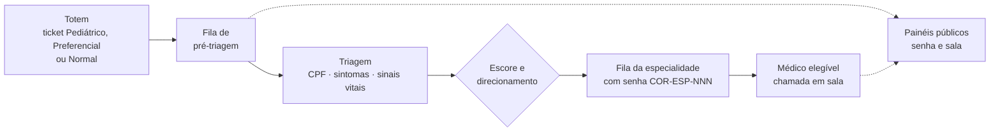
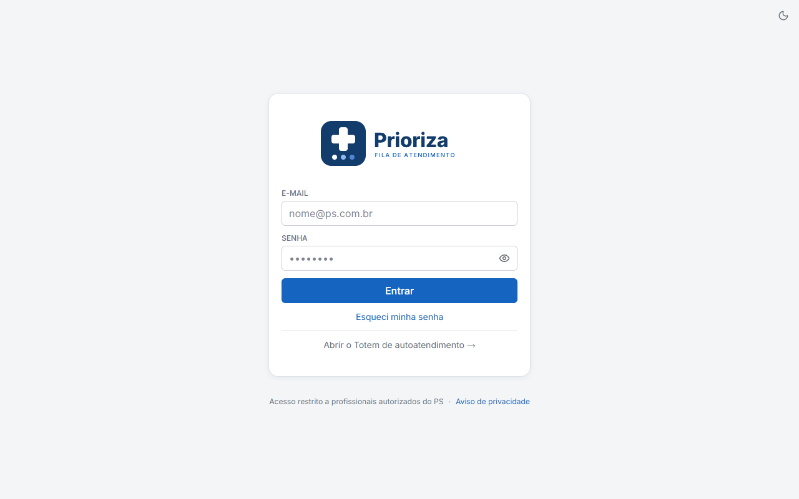
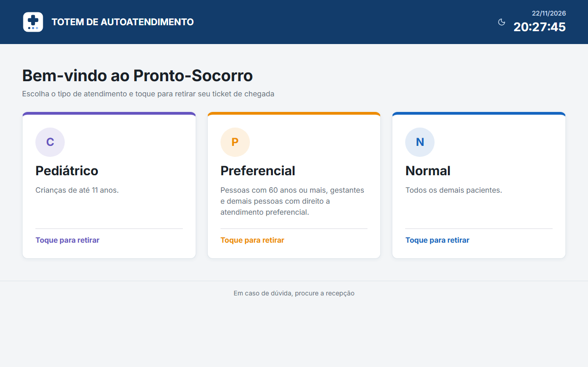
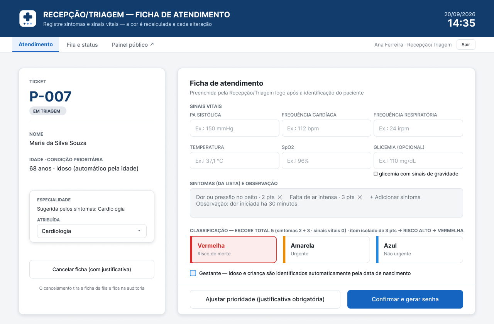
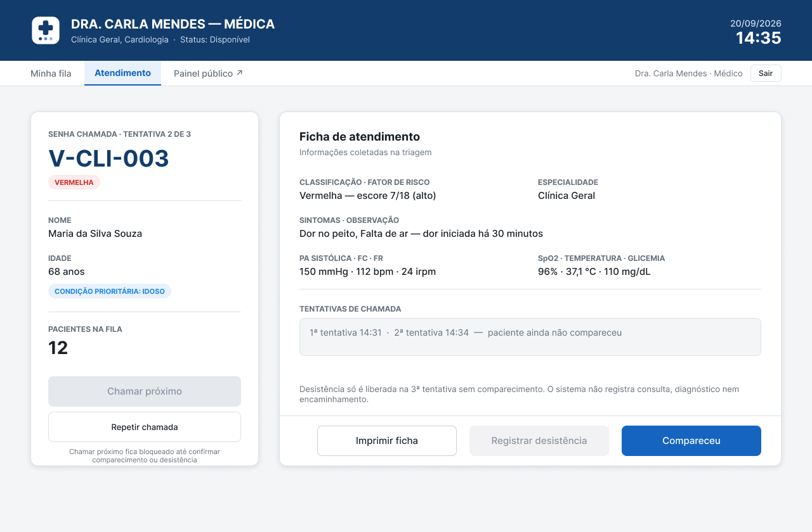
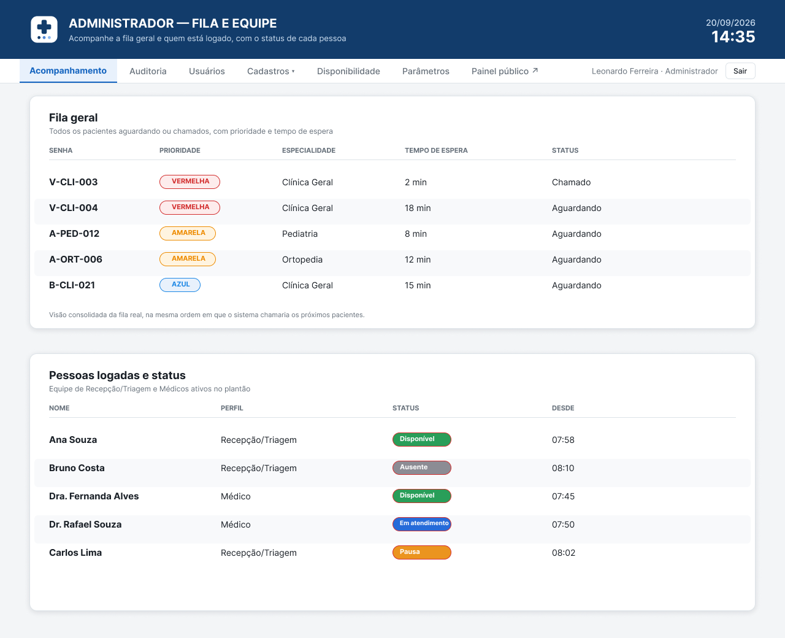
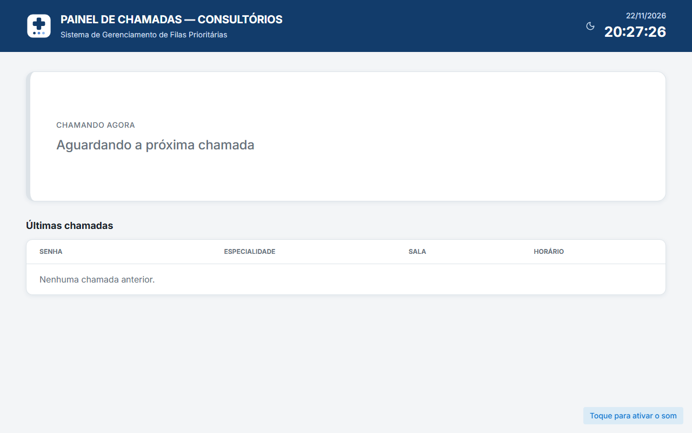
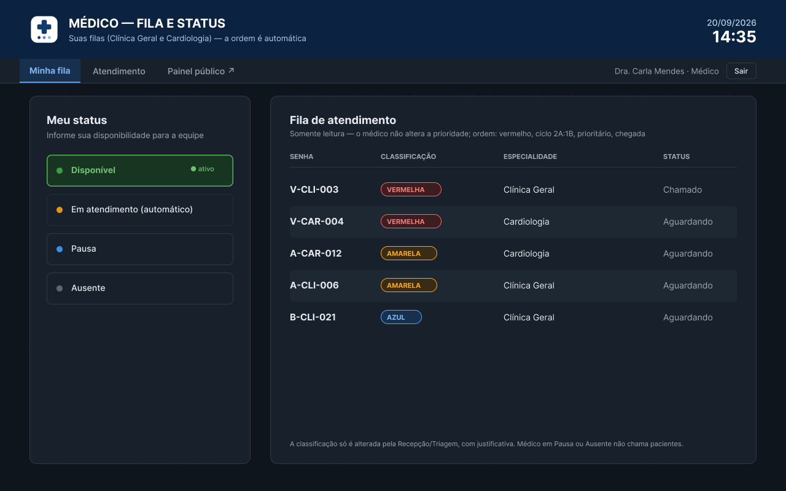
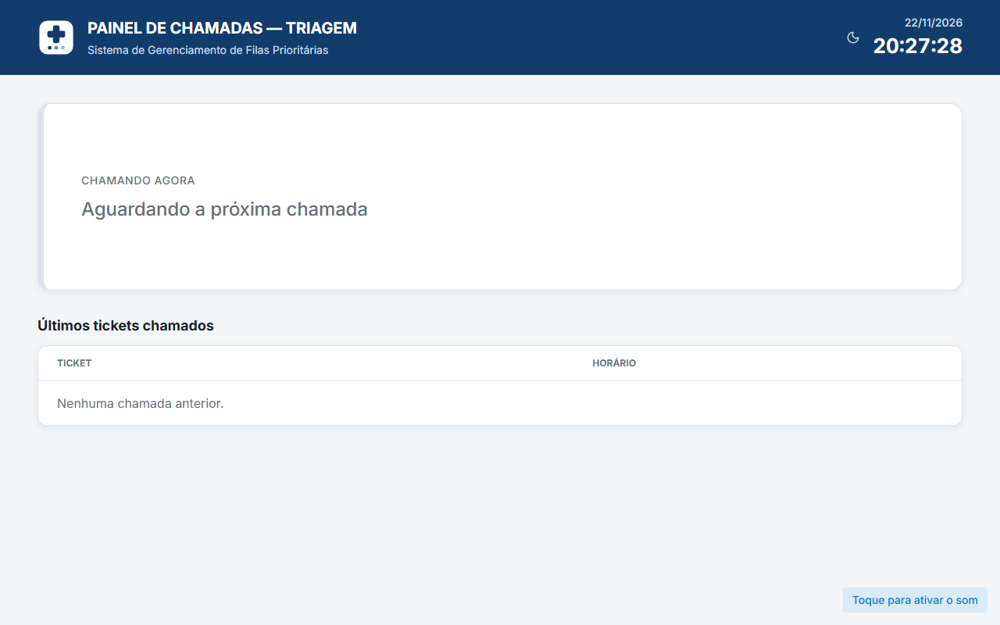
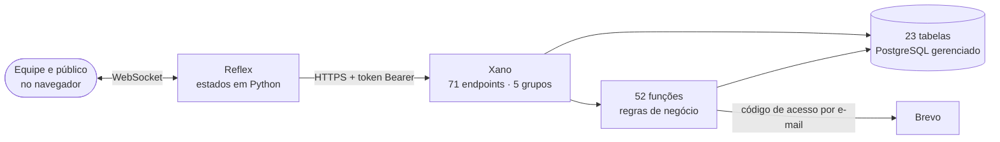

<div align="center">


# Prioriza

**Sistema de fila prioritária para pronto-socorro: o próximo paciente é escolhido pela gravidade clínica,**
**e não só pela ordem de chegada, com regras auditáveis e painéis públicos que não expõem dados pessoais.**

[](https://github.com/leonardo-sferreira/ps-fila-prioritaria/actions/workflows/ci.yml)
[](https://leonardo-sferreira.github.io/ps-fila-prioritaria/)


### [📘 Manual do usuário](https://leonardo-sferreira.github.io/ps-fila-prioritaria/usuario.html) · [🛠️ Documentação técnica](https://leonardo-sferreira.github.io/ps-fila-prioritaria/tecnica.html) · [🎨 Protótipo no Figma](https://www.figma.com/design/38ro8aKQfiGkUivIfCaOR1)

[Sobre](#sobre-o-projeto) · [Funcionalidades](#funcionalidades) · [Como funciona](#como-funciona) · [Telas](#telas) · [Arquitetura](#arquitetura) ·
[Regras](#regras-de-negócio-em-destaque) · [Segurança](#segurança-e-privacidade) · [Qualidade](#qualidade-e-testes) · [Como rodar](#como-rodar) · [Histórico](#histórico-do-projeto) · [Equipe](#equipe)

</div>

---

## Sobre o projeto

Em muitos prontos-socorros a fila ainda é organizada à mão, por ordem de chegada. Assim, um paciente com dor no peito pode esperar o mesmo tempo que alguém com um resfriado. Além disso:
- a decisão de quem é chamado depende de quem está no balcão;
- não fica registrado por que um paciente passou à frente de outro;
- o painel da sala de espera muitas vezes mostra o nome completo do paciente.

O **Prioriza** apoia a equipe com regras objetivas e auditáveis, em quatro frentes de acesso: **Totem e painéis públicos, Recepção/Triagem, Médico e Administrador**. O sistema:

- **classifica** cada paciente em três cores (Vermelha, Amarela e Azul), somando os pontos dos sintomas aos pontos dos sinais vitais;
- **direciona** a ficha à especialidade indicada pelos sintomas e gera uma senha;
- **escolhe sozinho** o próximo paciente quando o médico clica em "Chamar próximo": o médico não escolhe quem atender;
- **informa** a sala de espera por painéis que mostram só a senha e a sala, nunca nome ou CPF.

Todos os limiares, intervalos e ciclos são **parâmetros editáveis** pelo Administrador, e toda alteração relevante fica na **auditoria**: quem fez, o quê, quando, o valor anterior e a justificativa.

> **Trabalho acadêmico** da Faculdade Impacta, feito em grupo. As regras clínicas são uma modelagem de estudo e não substituem protocolos reais de triagem.

### Em números

<table>
<tr>
<td align="center"><b>33</b><br>telas</td>
<td align="center"><b>71</b><br>endpoints de API</td>
<td align="center"><b>23</b><br>tabelas</td>
<td align="center"><b>52</b><br>funções de regra</td>
<td align="center"><b>127</b><br>requisitos na spec</td>
<td align="center"><b>486</b><br>testes catalogados</td>
<td align="center"><b>25</b><br>changes entregues</td>
</tr>
</table>

Todas as funcionalidades planejadas foram **entregues, testadas e validadas pelo PO** e estão arquivadas no OpenSpec. Os roteiros de teste da Sprint 5 foram executados no sistema integrado (Xano `v1`). A documentação de usuário e técnica fica num [site próprio](https://leonardo-sferreira.github.io/ps-fila-prioritaria/), atualizado sozinho a cada merge na `main`.

---

## Funcionalidades

### 🎫 Paciente (sem login)

| Área | O que faz |
|---|---|
| **Totem** | Retirada de ticket sem nenhum dado pessoal, por tipo: Pediátrico (`C-001`), Preferencial (`P-001`) ou Normal (`N-001`), com sequência diária própria de cada tipo |
| **Painel dos consultórios** | "Chamando agora" com a senha, a especialidade, a Sala e a tentativa (1ª, 2ª…), mais as 4 chamadas anteriores; destaque visual e aviso sonoro; filtro por especialidade no endereço |
| **Painel da triagem** | Ticket chamado pela Recepção/Triagem e os 4 anteriores |
| **Aviso de privacidade** | Página pública que explica quais dados são tratados e para quê |

### 🩺 Recepção/Triagem

- **Fila de pré-triagem:** "Chamar próximo" na ordem da regra (pediátrico, preferencial e normal em ciclo 2:1), repetir a chamada, registrar presença, ausência ou desistência. Nada acontece sozinho: cada passo é decidido pela pessoa responsável.
- **Identificar o paciente:** busca pelo CPF e cadastro quando ele ainda não existe, sem duplicidade.
- **Ficha de atendimento:** sintomas do catálogo (e sintomas livres), queixa, sinais vitais e glicemia; classificação automática com ajuste manual justificado.
- **Direcionamento e senha:** especialidade sugerida pelos sintomas, senha `COR-ESP-NNN` e comprovante impresso de 80 mm sem dados pessoais.
- **Fichas do dia:** reabrir uma ficha em triagem ou reavaliar uma ficha que já está na fila (o paciente piorou, um dado foi digitado errado), com renumeração da senha e reimpressão.
- **Meu status:** Disponível, Pausa ou Ausente.

### 👩‍⚕️ Médico

- **Filas atribuídas** com a quantidade por especialidade, sem expor dados pessoais de quem está aguardando.
- **Chamar próximo:** o sistema escolhe a ficha, com reserva atômica para que dois médicos nunca peguem a mesma.
- **Chamada:** repetir após 30 s, até 3 tentativas por oportunidade e uma reentrada ao fim da fila; registrar comparecimento ou desistência.
- **Plantão:** ficar disponível, pausar ou retomar novas atribuições; encerrar só com a fila atribuída zerada.
- **Impressão da ficha** de triagem do paciente chamado.

### ⚙️ Administrador

- **Usuários e perfis:** criar, editar e desativar contas (o acesso cai na hora); não é possível deixar o sistema sem Administrador.
- **Cadastros:** médicos (com especialidades N:N e Sala), Recepção/Triagem, especialidades, sintomas (com pontuação e especialidades), salas.
- **Plantões:** disponibilidade por período, inclusive escala 12x36.
- **Parâmetros:** 16 regras editáveis com limites (limiares de cor, faixas de sinais vitais, intervalos, ciclos, tentativas, janela do painel).
- **Acompanhamento:** painel do plantão com indicadores do dia, equipe logada com status e fichas e tickets parados; fila geral com filtros; detalhe de cada ficha.
- **Auditoria:** alterações, chamadas e entradas e saídas por período, tipo e usuário, com exportação em CSV.

---

## Como funciona



Estados da ficha: `EM_TRIAGEM` → `AGUARDANDO` → `CHAMADO` → `ATENDIDO` ou `DESISTENCIA`. A responsabilidade do sistema termina quando o paciente comparece à chamada do médico ou desiste. Fichas e tickets parados por mais de 24 horas são dispensados pelo Administrador.

**Fora do escopo** (decisão do PO): prontuário, diagnóstico, prescrição, exames, agendamento, faturamento e duração da consulta.

---

## Telas

<table>
<tr>
<td width="50%"><br><sub><b>Entrar</b>: senha e código de 6 dígitos por e-mail (app)</sub></td>
<td width="50%"><br><sub><b>Totem</b>: ticket Pediátrico, Preferencial ou Normal, sem dado pessoal (app)</sub></td>
</tr>
<tr>
<td><br><sub><b>Ficha de atendimento</b>: sintomas, sinais vitais e cor recalculada a cada alteração (Figma)</sub></td>
<td><br><sub><b>Médico</b>: chamada em curso, tentativas e ficha da triagem (Figma)</sub></td>
</tr>
<tr>
<td><br><sub><b>Administrador</b>: fila geral na ordem de chamada e equipe com status (Figma)</sub></td>
<td><br><sub><b>Painel dos consultórios</b>: senha, especialidade e Sala, sem nome nem CPF (app, fora do plantão)</sub></td>
</tr>
<tr>
<td><br><sub><b>Modo escuro</b>: fila e status do médico (Figma)</sub></td>
<td><br><sub><b>Painel da triagem</b>: ticket chamado pela Recepção/Triagem (app, fora do plantão)</sub></td>
</tr>
</table>

As telas marcadas como "app" são capturas do sistema rodando; as marcadas como "Figma" vêm do protótipo, que segue o layout implementado. Todos os dados são fictícios.

| Perfil | Telas |
|---|---|
| **Público** | `/totem` · `/painel/medico` · `/painel/triagem` · `/privacidade` |
| **Acesso** | `/login` · `/login/codigo` · `/senha` (redefinição em 4 passos) · saída por inatividade |
| **Recepção/Triagem** | `/recepcao` · `/recepcao/fila` · `/recepcao/pacientes` · `/recepcao/ficha/{id}` · `/recepcao/comprovante/{id}` · `/recepcao/fichas` |
| **Médico** | `/medico` · `/medico/ficha/{id}/imprimir` |
| **Administrador** | `/admin` · `/admin/fila-geral` · `/admin/fichas/{id}` · `/admin/auditoria` · `/admin/usuarios` · `/admin/medicos` · `/admin/recepcao` · `/admin/especialidades` · `/admin/sintomas` · `/admin/salas` · `/admin/disponibilidade` · `/admin/parametros` |

Todas as telas foram desenhadas antes no [Figma](https://www.figma.com/design/38ro8aKQfiGkUivIfCaOR1), com modo claro e escuro. Os fluxos, as regras e o modelo de dados estão no [FigJam](https://www.figma.com/board/qwAbdFLbo9lRuOym4vDSBI). O passo a passo de cada tela, para quem usa o sistema, está no [manual do usuário](docs/usuario/manual-do-usuario.md).

---

## Arquitetura



- **O backend decide tudo:** regras de negócio, autorização por perfil, transações e auditoria ficam no Xano. O Reflex só apresenta e envia dados; esconder um botão nunca é controle de acesso.
- **Autorização em todo endpoint** por `auth/verificar_acesso`: sessão válida, usuário ativo e perfil permitido, conferidos a cada requisição.
- **Seleção atômica do próximo paciente:** a reserva da ficha acontece dentro de uma transação com trava de linha, para que dois médicos nunca chamem a mesma ficha.
- **Regras puras separadas do banco** (`pontuar`, `proxima_ficha`, `formatar_senha`…), cobertas por 105 testes nativos do Xano.
- **Backend como código:** tabelas, endpoints e funções são arquivos `.xs` versionados no Git e publicados pelo Xano CLI.
- **Nada com histórico é excluído:** cadastros são desativados (`ativo = false`), preservando a auditoria e os vínculos.

As 17 decisões de arquitetura, com motivo e custo de cada uma, estão na [documentação técnica](docs/tecnica/README.md#4-decisões-de-arquitetura).

### Stack

| Camada | Tecnologia | Uso |
|---|---|---|
| Frontend | [Reflex](https://reflex.dev) 0.10 (Python 3.12) | Telas por perfil, estados com chamadas à API, tema claro e escuro |
| Backend e banco | [Xano](https://www.xano.com) + XanoScript | API REST, banco relacional e regras, versionados em `backend/xano/` |
| E-mail | [Brevo](https://www.brevo.com) | Código de login e de redefinição de senha |
| Design | [Figma](https://www.figma.com/design/38ro8aKQfiGkUivIfCaOR1) e [FigJam](https://www.figma.com/board/qwAbdFLbo9lRuOym4vDSBI) | Protótipo das telas, fluxogramas, regras e modelo de dados |
| Especificação | [OpenSpec](https://github.com/Fission-AI/OpenSpec) | Explorar → Propor → Revisar → Aplicar → Arquivar |
| Testes | pytest, httpx e Playwright | Estados das telas, contratos, funções do Xano, integração ao vivo e E2E |
| CI e documentação | GitHub Actions + GitHub Pages | 6 jobs de evidência em todo push e PR; site da documentação |
| Planejamento | Trello | Sprints semanais |

---

## Regras de negócio em destaque

O mapa completo, com exemplos e o arquivo de cada regra, está em [`docs/tecnica/referencia/regras-de-negocio.md`](docs/tecnica/referencia/regras-de-negocio.md).

| Domínio | Regras |
|---|---|
| **Pré-triagem** | Pediátrico antes de Preferencial; prioritários e normais em ciclo 2:1, para ninguém esperar indefinidamente; 30 s entre chamadas do mesmo ticket, até 3 chamadas e uma reentrada. O tipo do ticket não altera a cor |
| **Classificação** | Escore = pontos dos sintomas (1 a 3 cada, todos somados) + pontos dos sinais vitais (0 a 3, incluindo glicemia). Azul de 0 a 4, Amarela de 5 a 9, Vermelha a partir de 10; um item isolado com 3 pontos já dá Vermelha. Ajuste manual exige justificativa |
| **Condição prioritária** | Idosos (60+), crianças (até 11) e gestantes passam à frente dentro da mesma cor, sem somar pontos |
| **Direcionamento** | Até 11 anos → Pediatria; senão o sintoma de maior pontuação, depois a maior soma, a menor fila e o menor ID; sem sintoma do catálogo → Clínica Geral |
| **Senha** | `COR-ESP-NNN`, numerada por especialidade e por dia; mudar só a cor troca a letra e mantém o número |
| **Fila do médico** | Vermelhas primeiro; ciclo de 2 Amarelas para 1 Azul; filas próprias antes, uma fila descoberta só passa à frente com cor mais grave; sem própria aguardando, o médico apoia outras filas sem mudar a senha da ficha |
| **Chamadas** | Sempre manuais; 30 s entre chamadas da mesma senha, até 3 tentativas por oportunidade e uma reentrada ao fim da fila; desistência tira a senha da fila |
| **Status da equipe** | Disponível, Pausa e Ausente manuais; Em atendimento automático ao confirmar o comparecimento; Pausa e Ausente impedem chamar |
| **Painéis** | Só senha, especialidade e Sala, nunca nome, CPF ou dado clínico; chamadas ficam visíveis por uma janela configurável (2 h), pois o PS funciona 24 horas |

Os valores acima são os iniciais: todos são parâmetros editáveis. O fuso do projeto é `America/Sao_Paulo`.

---

## Segurança e privacidade

- **Autenticação:**
  - login em duas etapas: senha e código de 6 dígitos por e-mail;
  - tentativas limitadas e consumo do código protegido contra envio duplicado ao mesmo tempo;
  - token de 12 horas e saída automática após 1 hora sem uso, pensada para os computadores compartilhados da recepção;
  - redefinição de senha por código válido por 10 minutos, sem revelar quais e-mails estão cadastrados.
- **Autorização:** perfil conferido no backend em todo endpoint; usuário desativado perde o acesso na hora.
- **Auditoria:** prioridade, sintomas, cadastros, disponibilidade e chamadas gravam usuário, data, valor anterior e novo e justificativa, na mesma transação da escrita. A trilha é imutável.
- **Privacidade por construção:**
  - painéis e comprovante respondem campo a campo, e um teste recursivo procura chaves proibidas (nome, CPF, nascimento, sintomas, sinais vitais);
  - CPF mascarado nas telas internas (`***.674.464-**`);
  - Totem sem nenhum dado pessoal;
  - [aviso de privacidade](docs/aviso-de-privacidade.md) público.
- **Totem protegido:** a emissão exige uma chave de dispositivo que fica só no servidor do Reflex e no Xano, nunca no navegador.
- **Repositório público sem segredos:** URLs do Xano, chaves e credenciais ficam em variáveis de ambiente.

---

## Qualidade e testes

O pipeline de CI ([`.github/workflows/ci.yml`](.github/workflows/ci.yml)) roda em todo push e Pull Request e publica as evidências de cada suíte (JSON, JUnit XML e resumo em Markdown):

| Suíte | O que verifica | Casos | Onde roda |
|---|---|---|---|
| `reflex` | Estados das telas, com a API simulada | 297 | CI e local |
| `xano-static` | Contratos lidos dos arquivos `.xs`, sem rede | 13 | CI e local |
| `xano-safe` | Funções puras executadas no Xano (testes nativos e Python), com valores-limite | 99 | CI |
| `e2e` | Navegador (Playwright) nas telas públicas | 2 | CI |
| `autotestes` | A própria infraestrutura de evidências | 42 | CI e local |
| `controlled` | Integração ao vivo na `v1`, com cenário sintético removido no fim | 33 | Local, com autorização |
| **Total catalogado** | | **486** | |

Cada caso tem um **ID permanente** no [catálogo de testes](docs/tecnica/testes/catalogo-de-testes.md), com objetivo, resultado esperado e a spec que cobre; o CI recusa teste sem registro. Um job final consolida as evidências das cinco suítes.

Além do pipeline:

- **Testes ao vivo na `v1`:** dois médicos chamando ao mesmo tempo recebem fichas diferentes; o mesmo código de login enviado duas vezes abre uma única sessão; o painel não devolve nenhuma chave de dado pessoal.
- **Roteiros da Sprint 5 executados no sistema integrado (20/11/2026):** Totem e pré-triagem, paciente e classificação (19 de 19), direcionamento e comprovante (11 de 11), fila do médico, privacidade em navegador real e Administrador.
- **Validação do PO:** fluxo completo do Totem à chamada do médico, acompanhado nos painéis e na tela do Administrador.
- **Defeito encontrado pelos roteiros e corrigido:** no direcionamento, um empate na maior pontuação ignorava a soma dos sintomas quando a especialidade tinha fila; a regra foi reescrita com dois testes nativos novos.

Comandos seguros e como ler os resultados: [guia de QA](docs/testes-qualidade.md) e [estratégia de testes](docs/tecnica/testes/estrategia-de-testes.md).

---

## Como rodar

> **Primeira vez no projeto?** Siga o [guia de contribuição](CONTRIBUTING.md) e o [guia de desenvolvimento](docs/tecnica/manutencao/guia-de-desenvolvimento.md): ferramentas, acesso ao Xano, fluxo de uma change e convenções.

Requisitos: Python 3.12+, Node.js 20+ e acesso ao workspace do Xano (pedir ao PO).

### Frontend

```bash
git clone https://github.com/leonardo-sferreira/ps-fila-prioritaria.git
cd ps-fila-prioritaria/frontend
python -m venv .venv
.venv\Scripts\activate          # Linux/macOS: source .venv/bin/activate
pip install -r requirements.txt pytest
copy .env.example .env          # Linux/macOS: cp — preencha as URLs dos 5 grupos de API e a TOTEM_CHAVE
reflex run                      # http://localhost:3000
```

### Backend (Xano)

1. Instale as ferramentas e crie um perfil do CLI só para este projeto:

   ```bash
   npm install -g @fission-ai/openspec @xano/cli
   xano auth -p ps-impacta
   xano branch create <seu-nome> -s v1
   ```

2. Publique `backend/xano/` **sempre com `--dry-run` antes** e só os arquivos alterados. Mudança de tabela passa pelo PO.
3. Configure as variáveis **no painel do Xano**, nunca no repositório:

| Variável | Para quê |
|---|---|
| `TOKEN_TTL_SEGUNDOS`, `INATIVIDADE_SEGUNDOS` | Validade da sessão (12 h) e saída por inatividade (1 h) |
| `CODIGO_TTL_SEGUNDOS`, `CODIGO_REENVIO_SEGUNDOS`, `CODIGO_TENTATIVAS` | Códigos de login e de redefinição de senha |
| `BREVO_API_KEY`, `BREVO_REMETENTE` | Envio de e-mail |
| `TOTEM_CHAVE` | Chave do dispositivo do Totem (o mesmo valor vai no `frontend/.env`) |

**Primeiro Administrador:** não há cadastro aberto. Crie o registro na tabela `usuario` pelo painel do Xano (perfil `ADMINISTRADOR`, `ativo = true`, senha com 8+ caracteres) e entre em `/login`; os demais usuários são criados pelo Administrador.

**Painéis numa TV:** abra `/painel/medico` ou `/painel/triagem`, coloque em tela cheia (F11) e toque uma vez em "Toque para ativar o som". Para mostrar só algumas especialidades: `/painel/medico?especialidades=CLI,ORT`.

Detalhes de ambientes, publicação e rollback: [deploy e ambientes](docs/tecnica/sustentacao/deploy-e-ambientes.md).

### Testes e documentação

Na raiz do repositório:

```bash
python scripts/run_test_evidence.py --suite reflex      --output test-evidence/local-reflex --require-execution --require-complete
python scripts/run_test_evidence.py --suite xano-static --output test-evidence/local-static --require-execution --require-complete
python scripts/gerar_docs.py    # regera contratos de API, dicionário de dados, catálogo de testes e changelog
```

Não use descoberta ampla do pytest nos diretórios de teste: eles também contêm integrações que escrevem no Xano. A suíte `xano-safe` e os testes `controlled` exigem CLI autenticado e autorização, conforme o [guia de QA](docs/testes-qualidade.md).

---

## Documentação

| Para quem | Documento |
|---|---|
| Quem usa o sistema | [Manual do usuário](docs/usuario/manual-do-usuario.md): o caminho do paciente, cada perfil, as regras explicadas e perguntas frequentes |
| Quem mantém o sistema | [Documentação técnica](docs/tecnica/README.md): arquitetura, decisões, dados, API, operação, testes realizados e limitações |
| Referência gerada do código | [Contratos de API](docs/tecnica/manutencao/contratos-api.md) · [dicionário de dados](docs/tecnica/manutencao/dicionario-de-dados.md) · [funções do Xano](docs/tecnica/manutencao/funcoes-xano.md) · [mapa tela → API](docs/tecnica/manutencao/mapa-telas-api.md) · [catálogo de testes](docs/tecnica/testes/catalogo-de-testes.md) |
| Contexto do produto | [Visão geral](docs/project-overview.md) · [modelo de domínio](docs/domain-model.md) · [especificações](openspec/specs/) |
| Referência formal | Confluence: RF01–RF50, RNF01–RNF10, RN01–RN35, UC01–UC12 e CA01–CA15 |

As decisões consolidadas do PO estão nos documentos-base; o Confluence é mantido sincronizado com elas.

---

## Estrutura do repositório

```text
AGENTS.md              Instruções para agentes de IA (CLAUDE.md e GEMINI.md apontam para ele)
CONTRIBUTING.md        Ambiente, acesso ao Xano e fluxo de trabalho da equipe
frontend/
  ps_fila_prioritaria/ App Reflex: paginas/ (telas), estados/ (dados e chamadas), api.py, componentes.py
  assets/              Logo, favicon e tema
  tests/               Testes dos estados das telas (API simulada)
backend/xano/
  table/               Esquema das 23 tabelas em XanoScript
  api/                 Endpoints por grupo: autenticacao, pacientes, triagem, fila, cadastros
  function/            Regras de negócio reutilizáveis, com testes nativos
openspec/
  specs/               Especificação consolidada (22 capacidades, 127 requisitos, 433 cenários)
  changes/archive/     Histórico das 25 changes entregues
docs/
  usuario/             Manual do usuário (fonte do site)
  tecnica/             Documentação técnica: manutencao/, sustentacao/, testes/, referencia/, evolucao/
  telas/               Prints usados neste README (dados fictícios)
  project-overview.md · domain-model.md · aviso-de-privacidade.md · testes-qualidade.md
tests/                 Testes ao vivo do Xano (api/), E2E, roteiros e catálogo de testes
scripts/               Execução das suítes, consolidação das evidências e geração da documentação
site/                  Estilo e script do site da documentação
.github/workflows/     CI de evidências e publicação no GitHub Pages
```

---

## Histórico do projeto

Todo o trabalho foi especificado antes no OpenSpec. As **25 changes** estão entregues e arquivadas em [`openspec/changes/archive/`](openspec/changes/archive/), em **72 Pull Requests**. O detalhe de cada entrega está no [changelog](docs/tecnica/evolucao/changelog.md).

| Sprint | O que foi entregue |
|---|---|
| **Setembro de 2026** | Levantamento de requisitos, protótipo no Figma, modelo de dados e as 23 tabelas no Xano |
| **Sprint 1 — Base e identificação** | Saneamento dos documentos-base com as decisões do PO; identificação e cadastro do paciente por CPF |
| **Sprint 2 — Ficha e triagem** | Ficha com sintomas e observação; segurança e auditoria nos endpoints de paciente |
| **Sprint 3 — Classificação, direcionamento e senha** | Chamada dos tickets, classificação em três cores, direcionamento, senha e comprovante, identidade visual Prioriza, privacidade, Totem, chamada manual na pré-triagem e reavaliação de ficha na fila |
| **Sprint 4 — Fila do médico e Administrador** | Fila e chamada do médico com seleção atômica, cadastros do Administrador, expiração em 24 h, fichas do dia, plantão 12x36, autenticação e perfis, base compartilhada (auditoria, fuso e parâmetros) e evidências de teste no CI |
| **Sprint 5 — Painel, testes e apresentação** | Painéis públicos dos consultórios e da triagem, acompanhamento do Administrador, roteiros de teste executados no sistema integrado, manual do usuário e documentação técnica |

### Versões

| Versão | Marco |
|---|---|
| [v0.1.0](https://github.com/leonardo-sferreira/ps-fila-prioritaria/releases/tag/v0.1.0) | Identificação do paciente e ficha de atendimento |

---

## Limitações conhecidas

- **Plano gratuito do Xano:** 10 requisições a cada 20 segundos para o sistema inteiro. Cada painel aberto faz 4 nesse tempo, então deixe só uma aba de cada painel; com mais, a equipe pode receber erro de limite e o painel mostra "Reconectando…".
- **Sem ambiente de produção:** o frontend roda numa máquina local apontando para o Xano `v1`, que também recebe os testes ao vivo (com dados sintéticos removidos no fim).
- **Sala nos painéis:** é a Sala atual do médico, não a do momento da chamada.
- **Sem monitoramento ou alertas** além do histórico de requisições do Xano.

A lista completa, com o impacto e a recomendação de cada item, está na [documentação técnica](docs/tecnica/README.md#14-limitações-conhecidas-riscos-e-dívida-técnica).

---

## Como contribuir

1. A `main` reflete sempre o estado estável e só recebe código por Pull Request com o CI verde.
2. Uma branch por tarefa, no Git e no Xano (criada a partir da `v1`).
3. Mudança funcional começa por uma change no OpenSpec (explorar → propor → revisar → aplicar → arquivar); tela começa pelo Figma.
4. Backend e frontend de uma funcionalidade entram juntos, na mesma change (fatia vertical).
5. Mudança de esquema do banco só com o PO; publicação no Xano sempre com `--dry-run` antes.
6. Agentes de IA seguem o [`AGENTS.md`](AGENTS.md).

O passo a passo completo está no [guia de contribuição](CONTRIBUTING.md).

---

## Equipe

| Integrante | Papel |
|---|---|
| Leonardo dos Santos Ferreira | Product Owner · requisitos e regras de negócio · protótipo · banco de dados · documentação |
| Luisa Jeronimo de Lima | Backend e QA · infraestrutura de testes, evidências e CI |
| Leonardo Machado | Backend |
| Nicolas Rissato | Frontend |
| Gustavo Garcia | Frontend |

<div align="center">
<sub>Prioriza · Trabalho acadêmico · Faculdade Impacta · <a href="https://leonardo-sferreira.github.io/ps-fila-prioritaria/">Documentação</a></sub>
</div>
