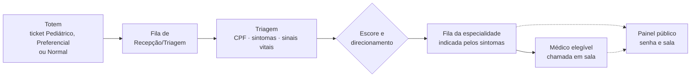
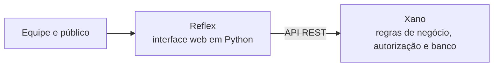

# Sistema de Fila Prioritária para Pronto-Socorro

Sistema web que organiza a entrada e a chamada de pacientes em um pronto-socorro, priorizando pela **gravidade clínica** (sintomas e sinais vitais), e não apenas pela ordem de chegada.


---

## Sobre o projeto

Em muitos prontos-socorros a fila ainda é organizada manualmente, por ordem de chegada. Assim, um paciente com dor no peito pode esperar o mesmo tempo que alguém com um resfriado. Este sistema apoia a equipe de triagem com regras objetivas e auditáveis:

- **classifica** cada paciente em três cores (Vermelha, Amarela e Azul), somando a pontuação de todos os sintomas aos pontos dos sinais vitais;
- **direciona** a ficha à especialidade indicada pelos sintomas e a distribui para um médico elegível, sem restringir atendimento pela especialidade cadastral do profissional;
- **escolhe automaticamente** o próximo paciente a ser chamado, sem que o médico escolha manualmente;
- **informa** o público por um painel de chamadas que não expõe dados pessoais.

> Projeto acadêmico desenvolvido na Faculdade Impacta. As regras clínicas são uma modelagem de estudo e não substituem protocolos reais de triagem.

## Principais funcionalidades

| Área | Funcionalidades |
|---|---|
| **Totem** | Retirada de ticket sem dados pessoais, por tipo: Pediátrico (`C-001`), Preferencial (`P-001`) ou Normal (`N-001`) |
| **Acesso da equipe** | Login por e-mail com perfil · redefinição de senha com código enviado por e-mail |
| **Recepção/Triagem** | Fila pré-triagem por tipo de ticket · identificação e cadastro pelo CPF · ficha com sintomas e sinais vitais · classificação automática com ajuste manual justificado · especialidade sugerida e atribuída · senha e comprovante impresso |
| **Médico** | Fila atribuída por elegibilidade · "Chamar próximo" sem duplicidade · 30 s entre chamadas, até 3 tentativas por oportunidade e uma reentrada ao fim da fila · Pausar/Retomar · encerrar plantão com fila zerada · impressão da ficha |
| **Painel público** | Senha e sala da chamada em destaque · previsão das próximas 5 senhas · sem nome nem CPF |
| **Administrador** | Usuários e perfis · cadastros de Médicos e Recepção/Triagem · especialidades, sintomas e salas · disponibilidade por período · parâmetros e faixas de risco · acompanhamento da fila, da equipe e da auditoria |

## Como funciona



### Regras de priorização

1. **Fila pré-triagem:** o tipo do ticket define quem é triado primeiro. Pediátrico vem antes de Preferencial, e prioritários e normais alternam em ciclo configurável (2 : 1), para que ninguém espere indefinidamente. O tipo não altera a cor definida na triagem.
2. **Pontuação de sintomas:** cada sintoma vale de 1 a 3 pontos e todos os sintomas selecionados entram na soma.
3. **Escore clínico:** soma os pontos dos sintomas e dos sinais vitais (incluindo glicemia quando medida). Não há máximo fixo de 18. Os limiares iniciais são 3 para risco moderado e 6 para alto; um item clínico isolado com 3 pontos pode elevar o risco a alto.
4. **Classificação:** baixo → Azul, moderado → Amarela e alto → Vermelha. Idosos, crianças e gestantes reordenam dentro da classificação e não somam pontos.
5. **Direcionamento:** os sintomas determinam a especialidade da ficha. Os vínculos N:N do médico definem suas especialidades próprias e a preferência operacional; ele pode apoiar filas descobertas ou outras cobertas sem alterar a especialidade nem a senha da ficha.
6. **Chamadas:** o médico respeita o intervalo configurável, inicialmente 30 segundos, entre chamadas da mesma senha, até 3 tentativas por oportunidade e uma única reentrada ao fim da mesma fila. A Recepção/Triagem usa os intervalos próprios da pré-triagem. Desistência explícita remove a senha da fila ativa.
7. **Painel:** a chamada pública pode mostrar a senha e a sala, nunca nome completo ou CPF.

Faixas e limiares clínicos são parametrizáveis. O fuso do projeto é `America/Sao_Paulo`.

## Arquitetura



| Camada | Tecnologia | Responsabilidade |
|---|---|---|
| Frontend | [Reflex](https://reflex.dev) (Python) | Telas e interação. Nenhuma regra de negócio |
| Backend e banco | [Xano](https://www.xano.com) (XanoScript) | Regras, autorização por perfil, persistência e auditoria |
| Especificação | [OpenSpec](https://github.com/Fission-AI/OpenSpec) | Requisitos e planejamento de cada funcionalidade |
| Testes | pytest + httpx | Testes de API com valores-limite das regras |

**Decisões de destaque**
- Autorização aplicada no backend a cada requisição. Desativar um usuário invalida o acesso na hora.
- Seleção do próximo paciente **atômica**, para que dois médicos nunca chamem a mesma ficha.
- Trilha de **auditoria** imutável para prioridade, sintomas, disponibilidade e chamadas.
- **Privacidade:** o painel e o comprovante impresso não exibem dados pessoais.
- **Totem:** desenvolvido pela equipe, emite tickets por tipo com código e sequência diária próprios.
- **Redefinição de senha:** código de 6 dígitos por e-mail, válido por 10 minutos, sem revelar quais e-mails estão cadastrados.
- **Plantão:** o Médico pode pausar ou retomar novas atribuições; só encerra o plantão quando sua fila atribuída estiver zerada.

## Design e documentação

| Artefato | Link |
|---|---|
| Protótipo de telas | [Figma — Protótipo de Fluxos](https://www.figma.com/design/38ro8aKQfiGkUivIfCaOR1) |
| Fluxogramas, regras e modelo de dados | [FigJam — Fluxo do Sistema](https://www.figma.com/board/qwAbdFLbo9lRuOym4vDSBI) |
| Visão geral do projeto | [docs/project-overview.md](docs/project-overview.md) |
| Modelo de domínio | [docs/domain-model.md](docs/domain-model.md) |
| Especificações (requisitos e cenários) | [openspec/changes/](openspec/changes/) |
| Referência formal | Confluence: RF01–RF50, RNF01–RNF10, RN01–RN35, UC01–UC12 e CA01–CA15 |

As decisões consolidadas do PO estão nos documentos-base. O Confluence deve permanecer sincronizado; não invente o texto de requisitos ausentes nem reintroduza regras antigas já substituídas.

## Metodologia

O projeto segue o desenvolvimento **orientado a especificação** com [OpenSpec](https://github.com/Fission-AI/OpenSpec), com apoio de agentes de IA:

1. **Contexto:** visão geral, modelo de domínio e regras para os agentes de IA ([AGENTS.md](AGENTS.md)).
2. **Especificação:** cada funcionalidade vira uma *change*, com proposta, requisitos verificáveis (cenários QUANDO/ENTÃO), design técnico e tarefas.
3. **Fatias verticais:** backend e frontend de uma mesma funcionalidade são entregues e testados juntos a cada sprint.
4. **Rastreabilidade:** os requisitos citam os RF/RN/CA do documento formal de requisitos.

## Roadmap

- [x] Levantamento de requisitos, protótipo e modelo de dados
- [x] Especificação de todas as funcionalidades no OpenSpec
- [x] Banco de dados publicado no Xano (19 tabelas)
- [x] Identificação e cadastro de pacientes por CPF — [v0.1.0](https://github.com/leonardo-sferreira/ps-fila-prioritaria/releases/tag/v0.1.0)
- [x] Ficha de atendimento com sintomas e observação — [v0.1.0](https://github.com/leonardo-sferreira/ps-fila-prioritaria/releases/tag/v0.1.0)
- [ ] Autenticação, perfis, gestão de usuários e redefinição de senha
- [ ] Base compartilhada: auditoria, fuso e parâmetros
- [ ] Totem com tickets Pediátrico, Preferencial e Normal
- [ ] Cadastros do administrador
- [ ] Triagem: sinais vitais e classificação de risco
- [ ] Direcionamento, senha e comprovante
- [ ] Fila priorizada e chamada pelo médico
- [ ] Painel público
- [ ] Acompanhamento do administrador

## Estrutura do repositório

```
├── docs/                  visão geral e modelo de domínio
├── openspec/
│   ├── config.yaml        contexto e regras da metodologia
│   ├── specs/             capacidades já entregues (pacientes, ficha, classificação)
│   └── changes/           especificação de cada funcionalidade (archive/ = entregues)
├── backend/xano/
│   ├── table/             schema do banco em XanoScript
│   ├── api/               endpoints (pacientes, triagem)
│   └── function/          funções reutilizáveis (CPF, catálogo de sintomas)
├── frontend/              app Reflex e testes (pytest)
├── AGENTS.md              regras para agentes de IA
└── CONTRIBUTING.md        guia de ambiente e fluxo de trabalho da equipe
```

## Executar localmente

```bash
cd frontend
python -m venv .venv
.venv\Scripts\activate          # Windows (Linux/macOS: source .venv/bin/activate)
pip install -r requirements.txt pytest
cp .env.example .env            # preencha as URLs da API do Xano
reflex run                      # http://localhost:3000
python -m pytest                # testes
```

Para verificar a ordem da fila médica publicada na `v1` do Xano, execute na raiz do repositório:

```bash
.venv/bin/python -m unittest discover -s tests/api -p test_ordenacao.py -v
```

O teste usa `xano function run` com o perfil `ps-impacta` (ou `XANO_TEST_PROFILE`) e espaça as chamadas para respeitar o limite do plano Free. A ordem interna é Vermelha antes de Amarela/Azul; sem Vermelha, o ciclo configurável é inicialmente A-A-B por especialidade. Condição prioritária precede não prioritária dentro da cor, seguida pela ordem efetiva da fila e pelo menor ID.

### Fila e chamada do médico

Configure `XANO_FILA_API_URL` no `frontend/.env` com a URL base do grupo **Fila**. Os endpoints exigem token de usuário e validam o perfil no Xano:

| Método e caminho | Resultado |
|---|---|
| `GET /medico/filas` | Status do médico, filas com quantidades e ficha atribuída; fichas aguardando não expõem dados pessoais. |
| `POST /medico/chamar-proximo` | Seleciona e reserva a próxima ficha, sem aceitar ID de ficha; retorna `fila_vazia` quando não há candidata. |
| `POST /medico/fichas/{id}/acao` | Recebe `REPETIR`, `COMPARECEU` ou `DESISTENCIA` para a ficha atribuída. |
| `GET /fichas/{id}/impressao` | Dados de triagem para o médico que chamou a ficha, enquanto ela está CHAMADO ou ATENDIDO. |
| `GET /filas/{especialidade}/previsao` | Próximas senhas e cores, sem reservar ficha nem expor dados pessoais. |

Na seleção, Vermelhas próprias precedem as demais próprias; Amarelas e Azuis próprias seguem rodízio por médico, mantendo o ciclo de cada especialidade. Uma descoberta supera a próxima própria somente se tiver cor mais grave. Empate favorece a própria. Sem própria aguardando, o médico apoia uma descoberta e depois outra coberta. PAUSA e AUSENTE retiram cobertura; EM_ATENDIMENTO a mantém.

Na raiz do repositório, os testes da seleção consultam funções publicadas na `v1`; o teste de chamada cria registros fictícios, encerra seus acessos ao final e preserva o histórico de auditoria:

```bash
.venv/bin/python -m unittest discover -s tests/api -p test_selecao_entre_filas.py -v
.venv/bin/python -m unittest discover -s tests/api -p test_chamada.py -v
cd frontend && ../.venv/bin/python -m unittest discover -s tests -p test_medico_state.py -v
```

### Primeiro administrador

Não existe tela de cadastro aberta: o primeiro Administrador é criado à mão no painel do Xano.

1. Abra a tabela **`usuario`** e use **Add record**.
2. Preencha nome, e-mail, senha (mínimo de 8 caracteres), **perfil** `ADMINISTRADOR` e **ativo** `true`.
3. Entre em `http://localhost:3000/login` com esse e-mail e senha. Os demais usuários são criados pelo Administrador.

As regras de tempo ficam em variáveis de ambiente do Xano (nunca no repositório): `TOKEN_TTL_SEGUNDOS` (validade da sessão, 12 h), `CODIGO_TTL_SEGUNDOS`, `CODIGO_REENVIO_SEGUNDOS` e `CODIGO_TENTATIVAS` (códigos por e-mail) e `INATIVIDADE_SEGUNDOS` (saída por inatividade, 1 h). O aviso de privacidade mostrado em `/privacidade` é o arquivo [docs/aviso-de-privacidade.md](docs/aviso-de-privacidade.md).

### Totem

O Totem fica em `http://localhost:3000/totem` e não pede login. Para emitir tickets, o servidor do Reflex usa uma chave de dispositivo:

1. No Xano, a variável de ambiente `TOTEM_CHAVE` guarda a chave (uma sequência aleatória longa).
2. No `frontend/.env`, `TOTEM_CHAVE=` recebe o **mesmo** valor. A chave nunca vai ao navegador nem ao repositório.
3. Para trocar a chave, altere os dois lugares e reinicie o `reflex run`.

Roteiro manual: abra `/totem`, toque em cada tipo e confira o código na tela (`C-001`, `P-001`, `N-001` no primeiro do dia), depois toque em **Concluir**. Com a chave errada no `.env`, a tela mostra "Não foi possível emitir o ticket." e nenhum ticket é criado. Os tickets emitidos aparecem na fila da Recepção/Triagem (`/recepcao/fila`).

Para os testes de integração do login, coloque no `frontend/.env` (nunca no repositório) as credenciais `TEST_ADMIN_*`, `TEST_RECEPCAO_*` e `TEST_MEDICO_*` de usuários de teste de cada perfil. Sem elas, esses testes são ignorados.

Detalhes do ambiente, do Xano e do fluxo de trabalho no [guia de contribuição](CONTRIBUTING.md).

## Equipe

| Integrante | Papel |
|---|---|
| Leonardo dos Santos Ferreira | Product Owner · requisitos e regras de negócio · protótipo · banco de dados |
| Leonardo Machado | Backend |
| Luisa | Backend |
| Nicolas Rissato | Frontend |
| Gustavo Garcia | Frontend |

---

Quer rodar ou contribuir? Veja o [guia de contribuição](CONTRIBUTING.md).
