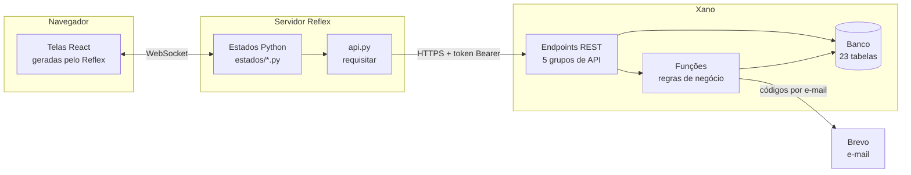
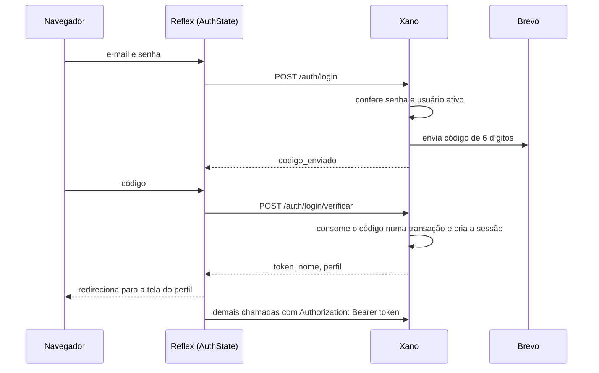

# Arquitetura do software e stacks

## Visão geral

O sistema tem duas partes: a **interface web**, em Reflex (Python), e o **backend com banco de dados**, no Xano. Toda regra de negócio, autorização e gravação acontece no Xano. O Reflex só mostra telas, guarda o estado da tela e chama a API.



| Camada | Tecnologia | Papel |
|---|---|---|
| Tela | Reflex 0.10 → React/Next.js (compilado pelo Reflex) | Componentes visuais, tema claro/escuro (`assets/tema.css`) |
| Estado da tela | Python, classes `rx.State` | Guarda o que a tela mostra, valida o básico e chama a API. Roda no servidor Reflex e conversa com o navegador por WebSocket |
| Cliente HTTP | `httpx` em `frontend/ps_fila_prioritaria/api.py` | Monta a URL do grupo de API a partir do `.env` e envia o token |
| API | Xano, endpoints em XanoScript | Autorização por perfil, validação e orquestração |
| Regras | Xano, funções em XanoScript | Classificação, direcionamento, senha, seleção da fila e auditoria |
| Dados | Banco do Xano (PostgreSQL gerenciado) | Tabelas em `backend/xano/table/` |
| E-mail | Brevo (API) | Envio dos códigos de login e de redefinição de senha |
| Especificação | OpenSpec | Requisitos, design e tarefas de cada funcionalidade (`openspec/`) |
| Testes e CI | pytest, Playwright, GitHub Actions | [Estratégia de testes](../testes/estrategia-de-testes.md) |

**Por que assim:** o Reflex permite escrever a interface em Python, sem JavaScript; o Xano dá banco, API e funções sem servidor próprio. Como o frontend não é controle de acesso, cada endpoint protegido chama `auth/verificar_acesso` antes de qualquer coisa.

## Estrutura do repositório

```
├── frontend/                       Aplicação Reflex
│   ├── rxconfig.py                 Configuração do Reflex (nome do app, plugins)
│   ├── requirements.txt            Dependências Python fixadas
│   ├── .env.example                Modelo das variáveis (URLs do Xano, chave do Totem)
│   ├── assets/                     Logo, ícones e tema (tema.css: cores claro/escuro)
│   ├── ps_fila_prioritaria/
│   │   ├── ps_fila_prioritaria.py  Ponto de entrada: registra as rotas (app.add_page)
│   │   ├── paginas/                Uma função por tela (layout e componentes)
│   │   ├── estados/                Estado e lógica de cada tela (rx.State), chamadas à API
│   │   ├── componentes.py          Cabeçalho, menus, cores e proteção por perfil
│   │   ├── comum.py                Utilidades: datas no fuso do PS, formatação, mensagens de erro
│   │   └── api.py                  Cliente HTTP único para o Xano
│   └── tests/                      Testes dos estados (API simulada) e de integração de login
├── backend/xano/                   Cópia em código do workspace do Xano
│   ├── api/<grupo>/                Endpoints (um arquivo .xs por endpoint) e api_group.xs
│   ├── function/<área>/            Funções reutilizáveis (regras de negócio, testes nativos)
│   └── table/                      Esquema das tabelas
├── openspec/
│   ├── specs/                      Comportamento implementado, por capacidade
│   └── changes/archive/            Histórico de cada funcionalidade entregue
├── tests/                          Testes ao vivo do Xano (api/), E2E (e2e/), catálogo e roteiros
├── scripts/                        Execução das suítes de teste, evidências e geração de docs
├── docs/                           Esta documentação
└── .github/workflows/ci.yml        Esteira de CI
```

## Frontend em detalhe

Cada tela segue o mesmo caminho:

1. `ps_fila_prioritaria.py` registra a rota com `app.add_page(funcao, route=..., on_load=[...])`. Telas da equipe têm `AuthState.verificar_sessao("PERFIL")` no `on_load`, que manda para o login (sem sessão) ou para a tela inicial do perfil (perfil errado).
2. A função em `paginas/` monta a tela e liga botões a eventos do estado.
3. O estado em `estados/` chama `api.requisitar(metodo, "XANO_<GRUPO>_API_URL", caminho, token=...)`. Resposta 401 encerra a sessão local e volta ao login; outros erros viram mensagem na tela (`comum._mensagem_erro`).
4. Telas que acompanham a operação atualizam sozinhas com `rx.moment(interval=...)`: painéis (5 s), fila geral (10 s), fichas do dia (15 s), início da Recepção e equipe do dashboard (30 s). A fila de pré-triagem usa uma tarefa em segundo plano (`FilaTicketsState.monitorar`) para os contadores de intervalo.

O mapa completo de qual tela usa qual estado e quais endpoints está em [mapa-telas-api.md](mapa-telas-api.md).

| Módulo de estado | Responsabilidade |
|---|---|
| `autenticacao.py` | Login em duas etapas, sessão, logout, inatividade, redefinição de senha (`AuthState`, `SenhaState`) |
| `totem.py` | Emissão de ticket (a chave do Totem fica só no servidor) |
| `fila_pre_triagem.py` | Fila de tickets e ações de chamada da Recepção |
| `pacientes.py` | Busca, cadastro e edição de paciente; abertura da ficha |
| `ficha.py` | Ficha: sintomas, sinais vitais, classificação, ajuste e confirmação |
| `comprovante.py`, `fichas_do_dia.py`, `plantao.py`, `status_equipe.py` | Comprovante, lista do dia, resumo do plantão, status da Recepção |
| `medico.py` | Status do médico, chamada, ações sobre a ficha, impressão |
| `cadastros.py`, `usuarios.py` | Telas de cadastro do Administrador (CRUD genérico por `CAMINHO`) |
| `equipe.py`, `expiracao.py`, `acompanhamento.py`, `auditoria.py` | Dashboard, registros parados, fila geral, detalhe da ficha, auditoria e CSV |
| `painel.py` | Painéis públicos: atualização, detecção de chamada nova e som |

## Backend em detalhe

| Grupo de API | Variável no `.env` | O que cobre |
|---|---|---|
| Autenticacao | `XANO_AUTH_API_URL` | Login, código, logout, `auth/me`, redefinição de senha, status próprio |
| Pacientes | `XANO_API_URL` | Busca, cadastro e edição de paciente |
| Triagem | `XANO_TRIAGEM_API_URL` | Totem, tickets, fichas, classificação, senha, comprovante, registros parados |
| Fila | `XANO_FILA_API_URL` | Filas e chamada do médico, previsão, impressão, painel público |
| Cadastros | `XANO_CADASTROS_API_URL` | Usuários, médicos, Recepção, especialidades, sintomas, salas, plantões, parâmetros, faixas, acompanhamento e auditoria |

Padrões usados em todos os endpoints:

- **Autorização:** `function.run "auth/verificar_acesso" {perfis_permitidos: [...]}` no início. Ela recarrega o usuário do token e responde 401 se ele não existir ou estiver inativo, e 403 se o perfil não for permitido. A sessão aberta é conferida à parte, onde importa (por exemplo, `auth/me` e o status operacional).
- **Transação:** escritas relacionadas ficam em `db.transaction`. Disputas, como dois médicos chamando ao mesmo tempo ou o mesmo código de login enviado duas vezes, travam uma linha com uma escrita real antes de reler o dado.
- **Auditoria:** toda alteração relevante chama `registrar_alteracao` na mesma transação.
- **Parâmetros:** regras configuráveis são lidas da tabela `parametro`; as funções `inicializar_*` criam os valores iniciais quando faltam.
- **Funções puras** (sem banco), como `classificacao/pontuar`, `fila/proxima_ficha` e `direcionamento/formatar_senha`, têm testes nativos (`test "..."` no próprio arquivo).

Detalhes: [contratos de API](contratos-api.md), [funções](funcoes-xano.md), [dicionário de dados](dicionario-de-dados.md) e [modelo de dados](modelo-de-dados.md).

## Fluxo de uma requisição: exemplo do login



## Como o código é mantido em sincronia com o Xano

O Xano é editado por código: os arquivos `.xs` em `backend/xano/` são a fonte, publicados com o Xano CLI (`xano workspace push`). O passo a passo, com a simulação antes de cada publicação, está em [deploy e ambientes](../sustentacao/deploy-e-ambientes.md).
