# Dicionário de dados e DER

> Arquivo gerado por `python scripts/gerar_docs.py`. Não edite à mão: altere o código e gere de novo.

Tabelas do banco do Xano (`backend/xano/table/`). O diagrama mostra as chaves estrangeiras declaradas (`campo { table = "..." }`). O caminho funcional dos dados está em [modelo-de-dados.md](modelo-de-dados.md).

## Diagrama entidade-relacionamento

```mermaid
erDiagram
    ficha_atendimento ||--o{ chamada : "ficha_id"
    medico ||--o{ chamada : "medico_id"
    especialidade ||--o{ ciclo_fila : "especialidade_id"
    usuario ||--o{ codigo_verificacao : "usuario_id"
    especialidade ||--o{ contador_senha : "especialidade_id"
    medico ||--o{ disponibilidade_medico : "medico_id"
    especialidade ||--o{ especialidade_alternativa : "especialidade_id"
    especialidade ||--o{ especialidade_alternativa : "alternativa_id"
    paciente ||--o{ ficha_atendimento : "paciente_id"
    ticket_pre_triagem ||--o{ ficha_atendimento : "ticket_id"
    usuario ||--o{ ficha_atendimento : "aberta_por"
    especialidade ||--o{ ficha_atendimento : "especialidade_sugerida_id"
    especialidade ||--o{ ficha_atendimento : "especialidade_atribuida_id"
    medico ||--o{ ficha_atendimento : "medico_chamada_id"
    ficha_atendimento ||--o{ ficha_sintoma : "ficha_id"
    sintoma ||--o{ ficha_sintoma : "sintoma_id"
    ficha_atendimento ||--o{ ficha_sintoma_livre : "ficha_id"
    usuario ||--o{ ficha_sintoma_livre : "criado_por"
    usuario ||--o{ historico_alteracao : "usuario_id"
    usuario ||--o{ medico : "usuario_id"
    sala ||--o{ medico : "sala_id"
    medico ||--o{ medico_especialidade : "medico_id"
    especialidade ||--o{ medico_especialidade : "especialidade_id"
    usuario ||--o{ recepcao_triagem : "usuario_id"
    especialidade ||--o{ recepcao_triagem : "especialidade_referencia_id"
    usuario ||--o{ sessao : "usuario_id"
    sintoma ||--o{ sintoma_especialidade : "sintoma_id"
    especialidade ||--o{ sintoma_especialidade : "especialidade_id"
    usuario ||--o{ ticket_pre_triagem : "chamado_por"
    paciente ||--o{ ticket_pre_triagem : "paciente_id"
    chamada {
        int id PK
        timestamp created_at
        int ficha_id FK
        int medico_id FK
        int tentativa
        int oportunidade
        enum tipo
    }
    ciclo_fila {
        int id PK
        timestamp created_at
        int especialidade_id FK
        int posicao
    }
    codigo_verificacao {
        int id PK
        timestamp created_at
        int usuario_id FK
        enum finalidade
        string codigo_hash
        timestamp iniciado_em
        timestamp criado_em
        timestamp expira_em
        int tentativas
        timestamp usado_em
    }
    contador_senha {
        int id PK
        timestamp created_at
        date data
        int especialidade_id FK
        int ultimo_numero
    }
    disponibilidade_medico {
        int id PK
        timestamp created_at
        int medico_id FK
        timestamp inicio
        timestamp fim
        timestamp encerrado_em
    }
    especialidade {
        int id PK
        timestamp created_at
        string nome
        string sigla
        string descricao
        boolean ativo
        string nome_normalizado
    }
    especialidade_alternativa {
        int id PK
        timestamp created_at
        int especialidade_id FK
        int alternativa_id FK
        int ordem
    }
    faixa_sinal_vital {
        int id PK
        timestamp created_at
        enum parametro
        decimal minimo
        decimal maximo
        int pontos
        boolean condicao_gravidade
    }
    ficha_atendimento {
        int id PK
        timestamp created_at
        int paciente_id FK
        int ticket_id FK
        int aberta_por FK
        timestamp chegada_em
        enum status
        string observacao
        boolean gestante
        int pa_sistolica
        int fc
        int fr
        decimal temperatura
        int spo2
        int glicemia
        boolean glicemia_sinais_gravidade
        int escore_risco
        boolean parametro_critico
        enum classificacao_risco
        enum prioridade_calculada
        enum prioridade_atual
        string justificativa_ajuste
        enum condicao_prioritaria
        int especialidade_sugerida_id FK
        int especialidade_atribuida_id FK
        string senha
        int senha_numero
        boolean sem_medico_no_direcionamento
        int medico_chamada_id FK
        int tentativas_chamada
        int oportunidade
        timestamp fila_em
        timestamp chamada_em
        timestamp finalizada_em
    }
    ficha_sintoma {
        int id PK
        timestamp created_at
        int ficha_id FK
        int sintoma_id FK
        string observacao
    }
    ficha_sintoma_livre {
        int id PK
        timestamp created_at
        int ficha_id FK
        string descricao
        int pontuacao
        int criado_por FK
    }
    historico_alteracao {
        int id PK
        timestamp created_at
        string tipo_evento
        string entidade
        int registro_id
        json valor_anterior
        json valor_novo
        string justificativa
        int usuario_id FK
    }
    medico {
        int id PK
        timestamp created_at
        int usuario_id FK
        string registro_profissional
        boolean ativo
        int sala_id FK
    }
    medico_especialidade {
        int id PK
        timestamp created_at
        int medico_id FK
        int especialidade_id FK
    }
    paciente {
        int id PK
        timestamp created_at
        string cpf
        string nome
        date data_nascimento
        string telefone
        boolean ativo
    }
    parametro {
        int id PK
        timestamp created_at
        string chave
        string valor
        enum tipo
    }
    recepcao_triagem {
        int id PK
        timestamp created_at
        int usuario_id FK
        string cpf
        int especialidade_referencia_id FK
        boolean ativo
    }
    sala {
        int id PK
        timestamp created_at
        string nome
        string nome_normalizado
        string descricao
        boolean ativo
    }
    sessao {
        int id PK
        timestamp created_at
        int usuario_id FK
        timestamp login_em
        timestamp logout_em
        timestamp expira_em
        enum status_operacional
    }
    sintoma {
        int id PK
        timestamp created_at
        string nome
        string descricao
        enum grupo
        int pontuacao
        boolean ativo
    }
    sintoma_especialidade {
        int id PK
        timestamp created_at
        int sintoma_id FK
        int especialidade_id FK
        int ordem
    }
    ticket_pre_triagem {
        int id PK
        timestamp created_at
        date data
        enum tipo
        int numero
        timestamp emitido_em
        enum status
        int oportunidade
        int tentativas
        boolean presente
        timestamp fila_em
        int chamado_por FK
        timestamp chamado_em
        int paciente_id FK
    }
    usuario {
        int id PK
        timestamp created_at
        string nome
        string email
        string password
        enum perfil
        boolean ativo
    }
```

## Tabelas

### `chamada`

Tentativas de chamada, comparecimentos e desistências.

Código: `backend/xano/table/chamada.xs`

| Campo | Tipo | Obrigatório | Detalhe |
|---|---|---|---|
| `id` | int | sim |  |
| `created_at` | timestamp | não | padrão `now` |
| `ficha_id` | int | sim | → `ficha_atendimento.id` |
| `medico_id` | int | sim | → `medico.id` |
| `tentativa` | int | sim |  |
| `oportunidade` | int | não | padrão `1` |
| `tipo` | enum | sim | valores: `CHAMADA`, `COMPARECIMENTO`, `DESISTENCIA` |

### `ciclo_fila`

Posição atual do ciclo amarelo/azul por especialidade.

Código: `backend/xano/table/ciclo_fila.xs`

| Campo | Tipo | Obrigatório | Detalhe |
|---|---|---|---|
| `id` | int | sim |  |
| `created_at` | timestamp | não | padrão `now` |
| `especialidade_id` | int | sim | → `especialidade.id` |
| `posicao` | int | não | padrão `1` |

### `codigo_verificacao`

Código de 6 dígitos enviado por e-mail no login e na redefinição de senha (design D12/D13).

Código: `backend/xano/table/codigo_verificacao.xs`

| Campo | Tipo | Obrigatório | Detalhe |
|---|---|---|---|
| `id` | int | sim |  |
| `created_at` | timestamp | não | padrão `now` |
| `usuario_id` | int | sim | → `usuario.id` |
| `finalidade` | enum | sim | valores: `LOGIN`, `REDEFINICAO_SENHA` |
| `codigo_hash` | text | sim | HMAC do código; o código em texto só segue por e-mail. |
| `iniciado_em` | timestamp | sim | Início do pedido (no login, quando a senha foi conferida); reenvios mantêm o mesmo valor. |
| `criado_em` | timestamp | sim |  |
| `expira_em` | timestamp | sim |  |
| `tentativas` | int | não | padrão `0` |
| `usado_em` | timestamp | não |  |

### `contador_senha`

Último número de senha emitido por especialidade e dia.

Código: `backend/xano/table/contador_senha.xs`

| Campo | Tipo | Obrigatório | Detalhe |
|---|---|---|---|
| `id` | int | sim |  |
| `created_at` | timestamp | não | padrão `now` |
| `data` | date | sim |  |
| `especialidade_id` | int | sim | → `especialidade.id` |
| `ultimo_numero` | int | não | padrão `0` |

### `disponibilidade_medico`

Período [inicio, fim) em que o médico atende, registrado pelo Administrador.

Código: `backend/xano/table/disponibilidade_medico.xs`

| Campo | Tipo | Obrigatório | Detalhe |
|---|---|---|---|
| `id` | int | sim |  |
| `created_at` | timestamp | não | padrão `now` |
| `medico_id` | int | sim | → `medico.id` |
| `inicio` | timestamp | sim |  |
| `fim` | timestamp | sim |  |
| `encerrado_em` | timestamp | não |  |

### `especialidade`

Área de atendimento; cada especialidade tem sua fila priorizada.

Código: `backend/xano/table/especialidade.xs`

| Campo | Tipo | Obrigatório | Detalhe |
|---|---|---|---|
| `id` | int | sim |  |
| `created_at` | timestamp | não | padrão `now` |
| `nome` | text | sim |  |
| `sigla` | text | sim |  |
| `descricao` | text | não |  |
| `ativo` | bool | não | padrão `true` |
| `nome_normalizado` | text | sim | Nome em minúsculas, sem espaços nas pontas, para a unicidade de nome nos cadastros do Administrador (publicado na v1 pela migração de especialidade de add-cadastros-administrador). |

### `especialidade_alternativa`

Alternativas ordenadas (fallback) de uma especialidade.

Código: `backend/xano/table/especialidade_alternativa.xs`

| Campo | Tipo | Obrigatório | Detalhe |
|---|---|---|---|
| `id` | int | sim |  |
| `created_at` | timestamp | não | padrão `now` |
| `especialidade_id` | int | sim | → `especialidade.id` |
| `alternativa_id` | int | sim | → `especialidade.id` |
| `ordem` | int | sim |  |

### `faixa_sinal_vital`

Faixas configuráveis de pontuação (0 a 3) de cada sinal vital.

Código: `backend/xano/table/faixa_sinal_vital.xs`

| Campo | Tipo | Obrigatório | Detalhe |
|---|---|---|---|
| `id` | int | sim |  |
| `created_at` | timestamp | não | padrão `now` |
| `parametro` | enum | sim | valores: `PA_SISTOLICA`, `FC`, `FR`, `TEMPERATURA`, `SPO2`, `GLICEMIA` |
| `minimo` | decimal | não | null = sem limite inferior; extremos inclusivos (add-classificacao-prioridade, D1). |
| `maximo` | decimal | não | null = sem limite superior. |
| `pontos` | int | sim |  |
| `condicao_gravidade` | bool | não |  |

### `ficha_atendimento`

Código: `backend/xano/table/ficha_atendimento.xs`

| Campo | Tipo | Obrigatório | Detalhe |
|---|---|---|---|
| `id` | int | sim |  |
| `created_at` | timestamp | não | padrão `now` |
| `paciente_id` | int | não | → `paciente.id`; ID do paciente associado à ficha de atendimento. |
| `ticket_id` | int | não | → `ticket_pre_triagem.id`; ID do ticket de pré-triagem associado. |
| `aberta_por` | int | não | → `usuario.id`; ID do usuário que abriu a ficha. |
| `chegada_em` | timestamp | não | Data e hora da chegada. |
| `status` | enum | não | valores: `EM_TRIAGEM`, `AGUARDANDO`, `CHAMADO`, `ATENDIDO`, `DESISTENCIA`, `CANCELADO`; Status atual da ficha de atendimento. |
| `observacao` | text | não | Observações adicionais para a ficha. |
| `gestante` | bool | não | Indica se a paciente é gestante. |
| `pa_sistolica` | int | não | Pressão arterial sistólica. |
| `fc` | int | não | Frequência cardíaca. |
| `fr` | int | não | Frequência respiratória. |
| `temperatura` | decimal | não | Temperatura corporal. |
| `spo2` | int | não | Saturação de oxigênio. |
| `glicemia` | int | não | Nível de glicemia. |
| `glicemia_sinais_gravidade` | bool | não | Indica sinais de gravidade relacionados à glicemia. |
| `escore_risco` | int | não | Escore de risco calculado. |
| `parametro_critico` | bool | não | Indica se há algum parâmetro crítico. |
| `classificacao_risco` | enum | não | valores: `BAIXO`, `MODERADO`, `ALTO`; Classificação de risco da ficha. |
| `prioridade_calculada` | enum | não | valores: `VERMELHA`, `AMARELA`, `AZUL`; Prioridade calculada automaticamente. |
| `prioridade_atual` | enum | não | valores: `VERMELHA`, `AMARELA`, `AZUL`; Prioridade atual atribuída. |
| `justificativa_ajuste` | text | não | Justificativa para ajuste de prioridade. |
| `condicao_prioritaria` | enum | não | valores: `NENHUMA`, `IDOSO`, `CRIANCA`, `GESTANTE`; padrão `NENHUMA`; Condição prioritária do paciente. |
| `especialidade_sugerida_id` | int | não | → `especialidade.id`; ID da especialidade sugerida para atendimento. |
| `especialidade_atribuida_id` | int | não | → `especialidade.id`; ID da especialidade atribuída para atendimento. |
| `senha` | text | não | Senha de atendimento. |
| `senha_numero` | int | não | Número da senha de atendimento. |
| `sem_medico_no_direcionamento` | bool | não | Indica se não há médico disponível para direcionamento. |
| `medico_chamada_id` | int | não | → `medico.id`; ID do médico responsável pela chamada. |
| `tentativas_chamada` | int | não | Número de tentativas de chamada. |
| `oportunidade` | int | não | padrão `1` |
| `fila_em` | timestamp | não |  |
| `chamada_em` | timestamp | não | Data e hora da chamada. |
| `finalizada_em` | timestamp | não | Data e hora de finalização da ficha. |

### `ficha_sintoma`

Sintomas registrados em uma ficha.

Código: `backend/xano/table/ficha_sintoma.xs`

| Campo | Tipo | Obrigatório | Detalhe |
|---|---|---|---|
| `id` | int | sim |  |
| `created_at` | timestamp | não | padrão `now` |
| `ficha_id` | int | sim | → `ficha_atendimento.id` |
| `sintoma_id` | int | sim | → `sintoma.id` |
| `observacao` | text | não |  |

### `ficha_sintoma_livre`

Sintoma digitado pela Recepção/Triagem que não está no catálogo (add-classificacao-prioridade, D9). Vale só para a ficha: não entra no catálogo nem em GET /sintomas.

Código: `backend/xano/table/ficha_sintoma_livre.xs`

| Campo | Tipo | Obrigatório | Detalhe |
|---|---|---|---|
| `id` | int | sim |  |
| `created_at` | timestamp | não | padrão `now` |
| `ficha_id` | int | sim | → `ficha_atendimento.id` |
| `descricao` | text | sim |  |
| `pontuacao` | int | sim | Gravidade escolhida pela Recepção/Triagem: 1 leve, 2 moderado, 3 grave. |
| `criado_por` | int | não | → `usuario.id` |

### `historico_alteracao`

Trilha de auditoria imutável.

Código: `backend/xano/table/historico_alteracao.xs`

| Campo | Tipo | Obrigatório | Detalhe |
|---|---|---|---|
| `id` | int | sim |  |
| `created_at` | timestamp | não | padrão `now` |
| `tipo_evento` | text | sim |  |
| `entidade` | text | sim |  |
| `registro_id` | int | não |  |
| `valor_anterior` | json | não |  |
| `valor_novo` | json | não |  |
| `justificativa` | text | não |  |
| `usuario_id` | int | não | → `usuario.id` |

### `medico`

Profissional que atende a fila priorizada (vinculado a um usuário MEDICO).

Código: `backend/xano/table/medico.xs`

| Campo | Tipo | Obrigatório | Detalhe |
|---|---|---|---|
| `id` | int | sim |  |
| `created_at` | timestamp | não | padrão `now` |
| `usuario_id` | int | sim | → `usuario.id` |
| `registro_profissional` | text | sim |  |
| `ativo` | bool | não | padrão `true` |
| `sala_id` | int | não | → `sala.id`; Sala atual do médico (opcional, sem histórico); só sala ativa (add-cadastros-administrador, D4). |

### `medico_especialidade`

Especialidades atendidas por um médico.

Código: `backend/xano/table/medico_especialidade.xs`

| Campo | Tipo | Obrigatório | Detalhe |
|---|---|---|---|
| `id` | int | sim |  |
| `created_at` | timestamp | não | padrão `now` |
| `medico_id` | int | sim | → `medico.id` |
| `especialidade_id` | int | sim | → `especialidade.id` |

### `paciente`

Pessoa atendida no PS, identificada pelo CPF.

Código: `backend/xano/table/paciente.xs`

| Campo | Tipo | Obrigatório | Detalhe |
|---|---|---|---|
| `id` | int | sim |  |
| `created_at` | timestamp | não | padrão `now` |
| `cpf` | text | sim |  |
| `nome` | text | sim |  |
| `data_nascimento` | date | sim |  |
| `telefone` | text | não |  |
| `ativo` | bool | não | padrão `true` |

### `parametro`

Parâmetros de regra configuráveis (chave-valor).

Código: `backend/xano/table/parametro.xs`

| Campo | Tipo | Obrigatório | Detalhe |
|---|---|---|---|
| `id` | int | sim |  |
| `created_at` | timestamp | não | padrão `now` |
| `chave` | text | sim |  |
| `valor` | text | sim |  |
| `tipo` | enum | sim | valores: `INTEIRO`, `ESPECIALIDADE` |

### `recepcao_triagem`

Cadastro da pessoa com perfil RECEPCAO_TRIAGEM, vinculado 1:1 ao usuário. O nome e o e-mail ficam no usuário. Desativado junto com o login, nunca excluído (add-cadastros-administrador, D3 e D5).

Código: `backend/xano/table/recepcao_triagem.xs`

| Campo | Tipo | Obrigatório | Detalhe |
|---|---|---|---|
| `id` | int | sim |  |
| `created_at` | timestamp | não | padrão `now` |
| `usuario_id` | int | sim | → `usuario.id` |
| `cpf` | text | sim | Só dígitos, validado por pacientes/normalizar_cpf. |
| `especialidade_referencia_id` | int | não | → `especialidade.id`; Cadastral; não limita a triagem. |
| `ativo` | bool | não | padrão `true` |

### `sala`

Local de atendimento; o médico pode ter uma sala atual (medico.sala_id). Desativada, nunca excluída (add-cadastros-administrador, D5).

Código: `backend/xano/table/sala.xs`

| Campo | Tipo | Obrigatório | Detalhe |
|---|---|---|---|
| `id` | int | sim |  |
| `created_at` | timestamp | não | padrão `now` |
| `nome` | text | sim |  |
| `nome_normalizado` | text | sim | lower(trim(nome)), para a unicidade sem diferenciar maiúsculas. |
| `descricao` | text | não |  |
| `ativo` | bool | não | padrão `true` |

### `sessao`

Registro de login/logout da equipe e status operacional.

Código: `backend/xano/table/sessao.xs`

| Campo | Tipo | Obrigatório | Detalhe |
|---|---|---|---|
| `id` | int | sim |  |
| `created_at` | timestamp | não | padrão `now` |
| `usuario_id` | int | sim | → `usuario.id` |
| `login_em` | timestamp | sim |  |
| `logout_em` | timestamp | não |  |
| `expira_em` | timestamp | sim |  |
| `status_operacional` | enum | não | valores: `DISPONIVEL`, `EM_ATENDIMENTO`, `PAUSA`, `AUSENTE` |

### `sintoma`

Queixa selecionável na triagem, com pontuação acadêmica para composição futura do escore.

Código: `backend/xano/table/sintoma.xs`

| Campo | Tipo | Obrigatório | Detalhe |
|---|---|---|---|
| `id` | int | sim |  |
| `created_at` | timestamp | não | padrão `now` |
| `nome` | text | sim |  |
| `descricao` | text | não |  |
| `grupo` | enum | sim | valores: `CARDIOVASCULAR`, `RESPIRATORIO`, `NEUROLOGICO`, `GASTROINTESTINAL`, `TRAUMATICO_ORTOPEDICO`, `TRAUMATICO_NEUROLOGICO`, `GERAL` |
| `pontuacao` | int | sim |  |
| `ativo` | bool | não | padrão `true` |

### `sintoma_especialidade`

Especialidades de um sintoma, em ordem de preferência.

Código: `backend/xano/table/sintoma_especialidade.xs`

| Campo | Tipo | Obrigatório | Detalhe |
|---|---|---|---|
| `id` | int | sim |  |
| `created_at` | timestamp | não | padrão `now` |
| `sintoma_id` | int | sim | → `sintoma.id` |
| `especialidade_id` | int | sim | → `especialidade.id` |
| `ordem` | int | sim |  |

### `ticket_pre_triagem`

Ticket emitido pelo Totem antes da triagem. Tipo autodeclarado (add-totem D5).

Código: `backend/xano/table/ticket_pre_triagem.xs`

| Campo | Tipo | Obrigatório | Detalhe |
|---|---|---|---|
| `id` | int | sim |  |
| `created_at` | timestamp | não | padrão `now` |
| `data` | date | sim |  |
| `tipo` | enum | não | valores: `PEDIATRICO`, `PREFERENCIAL`, `NORMAL`; padrão `NORMAL` |
| `numero` | int | sim |  |
| `emitido_em` | timestamp | sim |  |
| `status` | enum | sim | valores: `AGUARDANDO`, `CHAMADO`, `ATENDIDO`, `NAO_COMPARECEU`, `DESISTENCIA` |
| `oportunidade` | int | não | padrão `1` |
| `tentativas` | int | não | padrão `0` |
| `presente` | bool | não | padrão `false` |
| `fila_em` | timestamp | não |  |
| `chamado_por` | int | não | → `usuario.id` |
| `chamado_em` | timestamp | não |  |
| `paciente_id` | int | não | → `paciente.id` |

### `usuario`

Pessoa da equipe que acessa o sistema (tabela de autenticação).

Código: `backend/xano/table/usuario.xs`

| Campo | Tipo | Obrigatório | Detalhe |
|---|---|---|---|
| `id` | int | sim |  |
| `created_at` | timestamp | não | padrão `now` |
| `nome` | text | sim |  |
| `email` | email | sim |  |
| `password` | password | sim |  |
| `perfil` | enum | sim | valores: `RECEPCAO_TRIAGEM`, `MEDICO`, `ADMINISTRADOR` |
| `ativo` | bool | não | padrão `true` |

