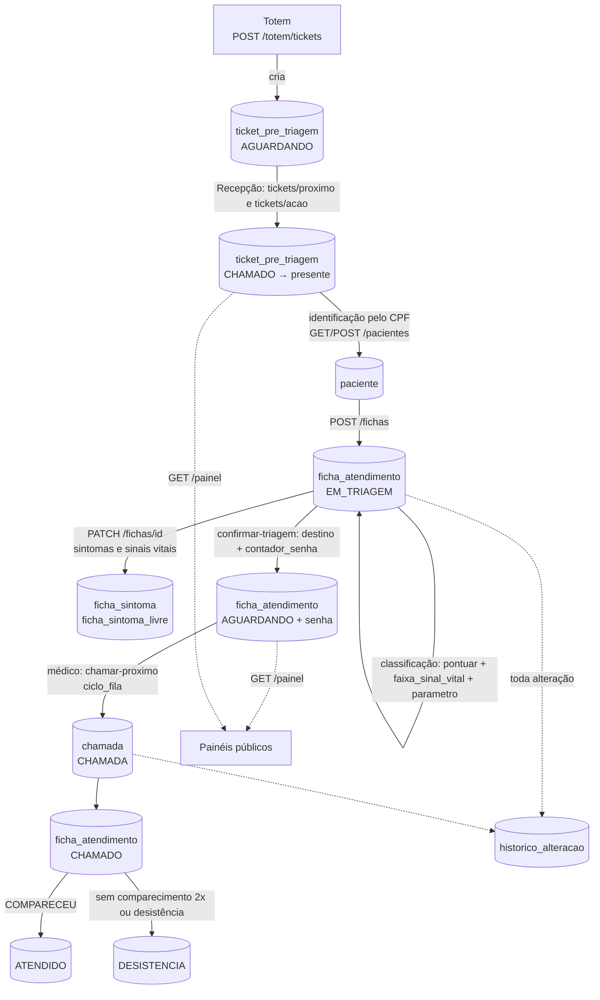

# Modelo de dados — caminho funcional

Como os dados entram no sistema, por onde passam e em quais tabelas ficam. Todas as tabelas estão no banco do Xano. Os campos de cada uma e o diagrama entidade-relacionamento completo estão no [dicionário de dados](dicionario-de-dados.md); as regras de negócio de cada entidade, no [modelo de domínio](../domain-model.md).

## Tabelas por bloco lógico

| Bloco | Tabelas | Quem grava |
|---|---|---|
| **Acesso** | `usuario`, `sessao`, `codigo_verificacao` | Administrador (usuários); login e logout (sessões e códigos) |
| **Cadastros da equipe** | `medico`, `medico_especialidade`, `recepcao_triagem`, `sala`, `disponibilidade_medico` | Administrador |
| **Catálogo clínico** | `especialidade`, `especialidade_alternativa`, `sintoma`, `sintoma_especialidade`, `faixa_sinal_vital` | Administrador; carga inicial pelo sistema |
| **Configuração** | `parametro` | Administrador; carga inicial pelo sistema |
| **Pré-triagem** | `ticket_pre_triagem` | Totem (cria) e Recepção (chama) |
| **Paciente e ficha** | `paciente`, `ficha_atendimento`, `ficha_sintoma`, `ficha_sintoma_livre`, `contador_senha` | Recepção/Triagem |
| **Fila médica** | `chamada`, `ciclo_fila` | Médico (chamadas); sistema (ciclo) |
| **Auditoria** | `historico_alteracao` | Sistema, em toda alteração relevante |

## Caminho do dado: do Totem ao atendimento

| Etapa | Dado que entra | Origem | Tabela | Endpoint |
|---|---|---|---|---|
| 1. Ticket | Tipo do ticket | Toque no Totem | `ticket_pre_triagem` (data, tipo, número do dia, status) | `POST /totem/tickets` |
| 2. Chamada da pré-triagem | Ação da Recepção | Tela da fila | `ticket_pre_triagem` (status, tentativas, `chamado_em`, `chamado_por`) | `POST /tickets/proximo`, `POST /tickets/{id}/acao` |
| 3. Identificação | CPF, nome, nascimento, telefone | Digitação da Recepção | `paciente` | `GET`/`POST`/`PATCH /pacientes` |
| 4. Abertura da ficha | Paciente e ticket | Botão "Continuar" | `ficha_atendimento` (`EM_TRIAGEM`, `chegada_em`, `aberta_por`) | `POST /fichas` |
| 5. Triagem | Sintomas, sinais vitais, observação, gestante | Digitação da Recepção | `ficha_sintoma`, `ficha_sintoma_livre`, colunas de sinais vitais da ficha | `PATCH /fichas/{id}` |
| 6. Classificação | — (calculado) | `classificacao/pontuar` com `faixa_sinal_vital` e `parametro` | `ficha_atendimento` (`escore_risco`, `prioridade_calculada`, `prioridade_atual`, `condicao_prioritaria`) | dentro do `PATCH` |
| 7. Ajuste manual | Cor e justificativa | Recepção | `ficha_atendimento` (`justificativa_ajuste`) e `historico_alteracao` | `POST /fichas/{id}/prioridade` |
| 8. Senha | — (calculado) | `direcionamento/*` com `sintoma_especialidade` e `contador_senha` | `ficha_atendimento` (`AGUARDANDO`, `senha`, especialidades sugerida e atribuída, `fila_em`) | `POST /fichas/{id}/confirmar-triagem` |
| 9. Chamada médica | Ação do médico | Tela do médico | `chamada` (tentativa, oportunidade, tipo), `ficha_atendimento` (`CHAMADO`, `medico_chamada_id`), `ciclo_fila`, `sessao` (`status_operacional`) | `POST /medico/chamar-proximo`, `POST /medico/fichas/{id}/acao` |
| 10. Encerramento | Compareceu ou desistência | Médico, ou o sistema na 2ª oportunidade | `ficha_atendimento` (`ATENDIDO` ou `DESISTENCIA`, `finalizada_em`) e `chamada` (`COMPARECIMENTO`/`DESISTENCIA`) | idem |
| 11. Exibição pública | — (leitura) | Painéis | Lê `chamada`, `ficha_atendimento`, `ticket_pre_triagem`, `medico`, `sala` | `GET /painel` |

## Estados

**Ficha de atendimento:** `EM_TRIAGEM` → `AGUARDANDO` → `CHAMADO` → `ATENDIDO` ou `DESISTENCIA`. `CANCELADO` existe para fichas descartadas. Uma ficha `CHAMADO` sem comparecimento na 1ª oportunidade volta para `AGUARDANDO` (reentrada).

**Ticket:** `AGUARDANDO` → `CHAMADO` → `ATENDIDO` (virou ficha), `NAO_COMPARECEU` ou `DESISTENCIA`.

**Sessão / status operacional:** `DISPONIVEL`, `PAUSA`, `AUSENTE` e `EM_ATENDIMENTO` (este, automático para o médico).

Diagramas de estado detalhados: [modelo de domínio](../domain-model.md#estados-da-ficha_atendimento).

## Origem e linhagem

| Dado | Origem | Quem pode alterar | Rastreio |
|---|---|---|---|
| Dados pessoais do paciente | Digitação da Recepção | Recepção (CPF não muda) | `historico_alteracao` (entidade `PACIENTE`) |
| Cor da ficha | Cálculo do sistema ou ajuste justificado | Recepção, enquanto a ficha não for chamada | `historico_alteracao` com valor anterior, novo e justificativa |
| Senha | Sistema (contador por especialidade e dia) | Muda só se a cor ou a especialidade mudar na reavaliação | `historico_alteracao` (as senhas anteriores aparecem no detalhe da ficha) |
| Chamadas | Ação do médico ou da Recepção | Ninguém (só inclusão) | Própria tabela `chamada`; tickets em `historico_alteracao` |
| Cadastros e parâmetros | Administrador, ou carga inicial | Administrador | `historico_alteracao`; a carga inicial aparece como "Sistema" |
| Acessos | Login e logout | Ninguém | `sessao` (login_em, logout_em) |

Registros com histórico não são apagados: usuários, médicos, especialidades, sintomas e salas são desativados (`ativo = false`). Fichas e tickets terminam em um estado final.

## Fuso e datas

Datas são gravadas como timestamp UTC (milissegundos) e mostradas no fuso `America/Sao_Paulo`. Campos `date`, como a data do ticket e a do plantão, usam a data local do PS.
