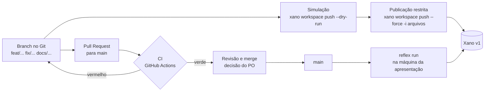

# Deploy e ambientes

Onde cada parte do sistema roda, como uma mudança chega até lá e o passo a passo de publicação.

## Ambientes

| Parte | Onde roda | Ambiente atual | Observação |
|---|---|---|---|
| Backend (endpoints, funções e banco) | Xano em nuvem, instância `x8ki-letl-twmt.n7.xano.io`, workspace **ps-impacta Workspace** (147348) | Branch **`v1`** do Xano, com o banco `live` | É o único ambiente de dados. Os testes ao vivo usam dados sintéticos identificados e os apagam no fim |
| Branches pessoais do Xano | Mesma instância | `xano branch create <nome> -s v1` | Para cada desenvolvedor testar endpoints; compartilham as tabelas da `v1` |
| Frontend (Reflex) | Máquina de quem roda `reflex run` | Desenvolvimento local, `http://localhost:3000` | Não há servidor de produção publicado. Na apresentação, roda numa máquina da equipe apontando para o Xano `v1` |
| E-mail | Brevo (API) | Conta do projeto | Envio dos códigos de login e redefinição |
| CI | GitHub Actions | Em todo push e Pull Request | Roda os testes e guarda as evidências |

> **Limite do plano gratuito do Xano:** 10 requisições a cada 20 segundos para o sistema inteiro. É o principal limitador de um uso real com várias telas e painéis abertos ([métricas](erros-e-metricas.md)).

## Esteira: do código à `v1`



1. **Branch:** toda mudança começa numa branch do Git criada a partir da `main`.
2. **Backend no Xano:** a mudança no `.xs` é publicada na `v1` pelo Xano CLI, sempre com a simulação antes e só os arquivos alterados (passo a passo abaixo). Isso acontece durante o desenvolvimento, porque os testes ao vivo precisam do endpoint publicado.
3. **Pull Request:** o PR para a `main` dispara o CI. Ele só segue com todos os checks verdes.
4. **Merge:** o PO (ou quem ele indicar) revisa e faz o merge. A regra da equipe é não fazer push direto na `main`.
5. **Frontend:** quem vai usar o sistema atualiza a `main` (`git pull`) e reinicia o `reflex run`.

A `main` hoje **não tem proteção técnica** no GitHub (a revisão obrigatória é combinada, não imposta). Recomendação para uma operação real: ativar a proteção da `main` com revisão e checks obrigatórios.

### Jobs do CI (`.github/workflows/ci.yml`)

| Job | O que roda | Precisa do Xano |
|---|---|---|
| Autotestes da infraestrutura | Testes do próprio pipeline de evidências | Não |
| Reflex local e mocks | Testes dos estados das telas com API simulada | Não |
| Xano estático local | Contratos lidos dos arquivos `.xs` | Não |
| E2E público local | Sobe o app e testa telas públicas no navegador (Playwright) | Não |
| Xano funções puras remotas | Testes nativos das funções puras no Xano, pelo CLI | Sim (secret `XANO_CLI_CONFIG_YAML`) |
| Consolidar evidências | Junta os resultados num relatório único | Não |

Cada job publica as evidências como artefato do GitHub Actions. Como ler: [validações operacionais](validacoes-operacionais.md).

## Passo a passo: publicar no Xano

Pré-requisito: perfil do CLI configurado ([guia de desenvolvimento](../manutencao/guia-de-desenvolvimento.md#acesso-ao-xano-pelo-cli)).

```bash
# 1. Simular: mostra o que seria criado ou atualizado, sem publicar
xano workspace push -d backend/xano -p ps-impacta -b v1 --dry-run -i "api/fila/painel_get.xs"

# 2. Conferir a lista "Changes": só os itens esperados (CREATE/UPDATE)

# 3. Publicar só esses arquivos
xano workspace push -d backend/xano -p ps-impacta -b v1 --force -i "api/fila/painel_get.xs"
```

Regras:

- **Sempre** usar `-i` com os arquivos alterados. Publicar o workspace inteiro pode sobrescrever trabalho de outras pessoas ou tabelas que divergem do repositório.
- Se a simulação mostrar **UPDATE** num item que você não esperava mudar, alguém pode ter alterado direto no Xano. Baixe a versão publicada (`xano workspace pull -d <pasta-temporária>`), compare e traga as mudanças para o repositório antes de publicar.
- Avisos `does not exist` na publicação restrita são esperados: o CLI não encontra as tabelas e funções que ficaram fora do `-i`.
- A publicação grava o `guid` no arquivo `.xs`; esse arquivo alterado vai no commit.
- Mudança de **esquema de tabela** só com o PO.
- O workspace pertence à conta de um membro da equipe; publicações precisam do aval dele.

## Passo a passo: rodar o frontend para uso

```bash
git switch main && git pull
cd frontend
.\.venv\Scripts\Activate.ps1        # Windows; no Linux/macOS: source .venv/bin/activate
pip install -r requirements.txt     # só se requirements.txt mudou
reflex run
```

Para um servidor de produção, o Reflex oferece `reflex run --env prod` (ou `reflex export` para gerar os arquivos estáticos do frontend e o backend separados) e a hospedagem na Reflex Cloud (`reflex deploy`). Nenhuma das duas foi configurada neste projeto. Em qualquer caso, o servidor precisa do `frontend/.env` com as URLs do Xano e a `TOTEM_CHAVE`.

## Rollback

| O quê | Como voltar |
|---|---|
| Endpoint ou função do Xano | Fazer `git checkout <commit-anterior> -- backend/xano/<arquivo>.xs` e publicar de novo esse arquivo (simulação + push restrito). O Xano também guarda o histórico de versões de cada endpoint na interface web |
| Frontend | `git revert <commit>` num PR, ou rodar o `reflex run` a partir de um commit anterior |
| Parâmetro alterado errado | Corrigir em Administrador → Parâmetros. O valor anterior está na auditoria |
| Dado alterado errado | Não há exclusão: corrigir pela tela correspondente. O valor anterior está em `historico_alteracao` |
| Esquema de tabela | Só com o PO. Mudanças de esquema são raras e combinadas antes |
