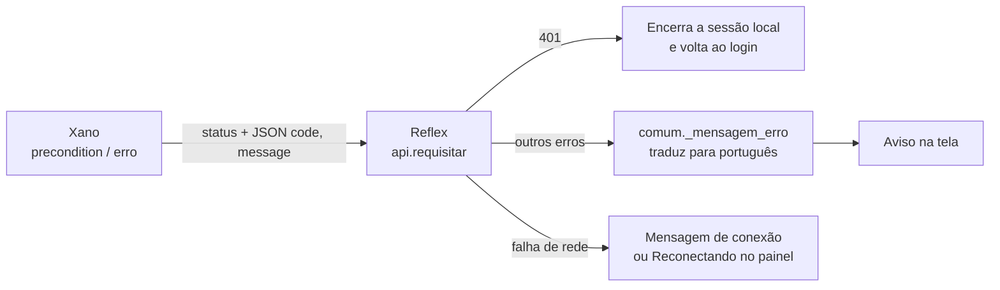

# Tratamento de erros e métricas

## Como os erros chegam à tela

O Xano responde erros como `{"code": "ERROR_CODE_...", "message": "..."}`. As regras usam `precondition` com mensagens já escritas para o usuário. Em `frontend/ps_fila_prioritaria/comum.py`, `_mensagem_erro` repassa a mensagem e traduz as técnicas, como "Missing param: cpf", que vira "Preencha o campo CPF.".

## Tabela de erros

| Status | Código Xano | Significado | Exemplos de mensagem | O que verificar |
|---|---|---|---|---|
| 400 | `ERROR_CODE_INPUT_ERROR` | Entrada inválida ou regra de negócio recusou | "Informe o e-mail.", "FICHA_FORA_DA_TRIAGEM", "Consulte no máximo 31 dias por vez.", "AGUARDE_INTERVALO:N" | Os dados enviados e a regra no `.xs` (a mensagem aparece no arquivo) |
| 401 | `ERROR_CODE_UNAUTHORIZED` | Sem sessão válida, token vencido, usuário inativo ou código errado | "Sessão expirada. Faça login novamente.", "Código inválido ou expirado" | Validade do token (12 h), inatividade (1 h), usuário ativo |
| 403 | `ERROR_CODE_ACCESS_DENIED` | Perfil sem permissão | "Acesso negado para o seu perfil." | Perfil do usuário × `perfis_permitidos` do endpoint |
| 404 | `ERROR_CODE_NOT_FOUND` | Registro não existe | "Ficha não encontrada.", "ESPECIALIDADE_NAO_ENCONTRADA" | ID da URL |
| 429 | `ERROR_CODE_TOO_MANY_REQUESTS` | Limite do plano gratuito: **10 requisições a cada 20 s** | "Your plan only supports 10 requests per 20 seconds" | Abas e painéis abertos; `reflex run` duplicados; testes rodando |
| 500 | `ERROR_FATAL` | Falha no XanoScript ou no banco | "Duplicate record detected." (índice único) | Request History do endpoint, que mostra a linha |
| — | (sem resposta) | Rede ou Xano fora | "Não foi possível conectar à API de ..." | Internet e status do Xano |
| — | (configuração) | Falta variável no `frontend/.env` | "Configure XANO_..._API_URL ..." | `.env` da máquina que roda o Reflex |

Todas as mensagens de cada endpoint estão em [contratos-api.md](../manutencao/contratos-api.md); as mais comuns para o usuário, no [FAQ](../uso/inicio-rapido-e-faq.md#perguntas-frequentes-e-erros-comuns).

### Erros por categoria

| Categoria | Exemplos | Onde é tratado |
|---|---|---|
| **Entrada de dados** (ingestão) | CPF inválido, data futura, sinal vital fora do limite, sintoma livre repetido, sigla sem 3 letras | Validação no Xano (`precondition`) e, para resposta rápida, no estado do Reflex |
| **Regra de negócio** (lógicos) | Chamar em Pausa, repetir antes de 30 s, ficha já chamada, desativar o último Administrador | `precondition` nas funções e endpoints, com mensagem para o usuário |
| **Concorrência** | Dois médicos chamando ao mesmo tempo; o mesmo código de login enviado duas vezes | Transação com trava de linha; o segundo recebe erro e tenta de novo ou é recusado |
| **Sessão e acesso** | Token vencido, perfil errado, usuário desativado | 401/403; o Reflex volta ao login ou à tela do perfil |
| **Infraestrutura** | 429, rede, variável faltando | Mensagem de conexão; painéis mantêm o último estado com "Reconectando…" |

## Métricas e monitoramento

O projeto não tem uma ferramenta de monitoramento própria. O que existe hoje:

| O que medir | Onde ver | Como |
|---|---|---|
| Número de requisições e erros por endpoint | Xano → endpoint → **Request History** | Lista de chamadas com status e tempo; filtrar por status ≥ 400 |
| Tempo de resposta | Xano → Request History (coluna de duração) | Endpoints de fila e painel fazem várias consultas; acima de 1 s merece atenção |
| Limite do plano (429) | Xano → Request History e o aviso "Reconectando…" nos painéis | Somar o consumo: cada painel faz 4 requisições a cada 20 s; cada tela com atualização automática soma mais |
| Uso por pessoa (acessos) | `/admin/auditoria`, origem "Acesso" | Logins e logouts por usuário e período; exportar CSV |
| Operação do plantão | `/admin` (equipe, status, registros parados) e `/admin/fila-geral` | Fichas por status e cor, tempo de espera de cada ficha |
| Alterações e chamadas | `/admin/auditoria` | Volume de chamadas, ajustes de cor e alterações de cadastro no período |
| Qualidade do código | GitHub Actions → evidências | Testes aprovados, falhas e erros por suíte |

**Consumo de requisições:** com o limite de 10 a cada 20 s, uma TV de painel (4) e uma tela do Administrador com equipe e plantão abertos já usam boa parte da cota. Para uma operação real, é preciso um plano pago do Xano ou intervalos maiores nos painéis.

### Sugestões para uma operação real

- Plano do Xano com limite compatível com o número de telas.
- Alertas sobre o Request History (status 5xx e 429) por e-mail.
- Painel de monitoramento simples a partir da auditoria exportada em CSV (chamadas por hora, tempo médio de espera por cor).
