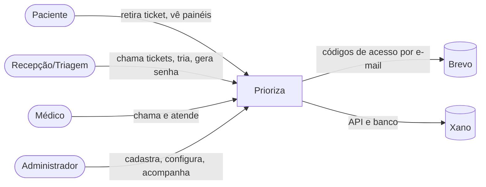
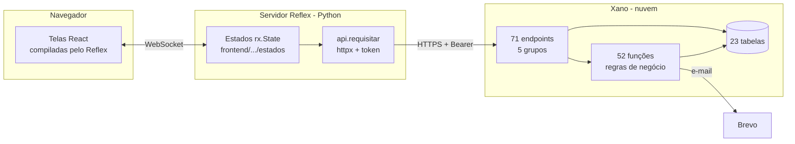
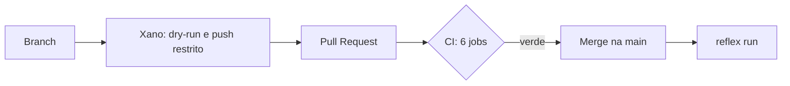

# Prioriza — Documentação técnica

**Sistema de Fila Prioritária para Pronto-Socorro.** Manual de engenharia para quem vai manter, operar ou evoluir o sistema. Lido do início ao fim, dá o entendimento do projeto inteiro; os anexos (seção 16) trazem o detalhe de cada assunto.

| | |
|---|---|
| **Público** | Desenvolvedores, quem assume a administração técnica, revisores e avaliadores |
| **Versão do sistema** | `main` de 20/11/2026 (fim da Sprint 5) |
| **Responsável** | Product Owner do projeto (seção 13) |
| **Atualização** | Partes marcadas com ⚙ são geradas do código por `python scripts/gerar_docs.py`. O restante é mantido à mão a cada mudança que o afete |

> Para quem só vai **usar** o sistema, o documento certo é o [Manual do usuário](../usuario/manual-do-usuario.md).

## Sumário

1. [Resumo](#1-resumo)
2. [Contexto e escopo](#2-contexto-e-escopo)
3. [Arquitetura](#3-arquitetura)
4. [Decisões de arquitetura](#4-decisões-de-arquitetura)
5. [Atributos de qualidade](#5-atributos-de-qualidade)
6. [Domínio e regras de negócio](#6-domínio-e-regras-de-negócio)
7. [Dados](#7-dados)
8. [API](#8-api)
9. [Configuração e segredos](#9-configuração-e-segredos)
10. [Ambiente de desenvolvimento](#10-ambiente-de-desenvolvimento)
11. [Entrega e operação](#11-entrega-e-operação)
12. [Testes realizados](#12-testes-realizados)
13. [Governança e responsáveis](#13-governança-e-responsáveis)
14. [Limitações conhecidas, riscos e dívida técnica](#14-limitações-conhecidas-riscos-e-dívida-técnica)
15. [Primeira semana de quem assume o projeto](#15-primeira-semana-de-quem-assume-o-projeto)
16. [Mapa dos anexos](#16-mapa-dos-anexos)

---

## 1. Resumo

O Prioriza organiza a entrada e a chamada de pacientes num pronto-socorro pela **gravidade clínica**, e não só pela ordem de chegada:

1. O paciente retira um ticket no Totem.
2. A Recepção/Triagem registra sintomas e sinais vitais.
3. O sistema calcula a cor de risco, direciona a ficha para uma especialidade e gera a senha.
4. O médico chama o próximo paciente, que o sistema escolhe.
5. Os painéis públicos mostram as chamadas sem expor dados pessoais.

| Indicador | Valor |
|---|---|
| Telas (rotas) | 33, em 4 perfis: público, Recepção/Triagem, Médico e Administrador |
| Endpoints REST | 71, em 5 grupos de API |
| Tabelas | 23 |
| Funções de regra no backend | 52 (105 testes nativos nelas) |
| Testes automatizados catalogados | 486 |
| Especificações implementadas | 22 capacidades em `openspec/specs/` |
| Funcionalidades entregues | 25 changes arquivadas, 72 PRs |
| Stack | Reflex 0.10 (Python) + Xano (XanoScript, PostgreSQL gerenciado) + Brevo (e-mail) |

**Estado:** todas as funcionalidades planejadas estão entregues e validadas pelo PO. Não há ambiente de produção publicado: o frontend roda em máquina local e aponta para o Xano (seção 11). As limitações conhecidas estão na seção 14.

> Projeto acadêmico (Faculdade Impacta). As regras clínicas são modelagem de estudo, não protocolo real de triagem.

## 2. Contexto e escopo



**No escopo:**
- Totem de tickets e fila de pré-triagem.
- Cadastro de paciente por CPF.
- Ficha com sintomas e sinais vitais, classificação de risco em três cores e ajuste justificado.
- Direcionamento por especialidade, senha e comprovante.
- Fila do médico com seleção automática e chamada.
- Painéis públicos.
- Cadastros do Administrador, acompanhamento e auditoria.
- Login com código por e-mail.

**Fora do escopo** (decisão do PO): prontuário, diagnóstico, prescrição, exames, agendamento, faturamento, encaminhamento clínico e controle da duração da consulta. A responsabilidade do sistema termina quando o paciente comparece à chamada do médico ou desiste.

Fontes de requisito: documento formal no Confluence (RF01–RF50, RNF01–RNF10, RN01–RN35, UC01–UC12, CA01–CA15), [visão geral](../project-overview.md) e [modelo de domínio](../domain-model.md), que registram as decisões do PO.

## 3. Arquitetura



| Camada | Responsabilidade | Onde |
|---|---|---|
| Tela | Layout e componentes; nenhuma regra de negócio | `frontend/ps_fila_prioritaria/paginas/` |
| Estado | Dados da tela, validação básica, chamadas à API, tratamento de 401 e de erros | `frontend/ps_fila_prioritaria/estados/` |
| Cliente HTTP | URL por grupo de API, token Bearer, TLS do sistema operacional | `frontend/ps_fila_prioritaria/api.py` |
| Endpoint | Autorização por perfil, validação, transação e auditoria | `backend/xano/api/<grupo>/*.xs` |
| Função | Regras reutilizáveis; as puras têm testes nativos | `backend/xano/function/**/*.xs` |
| Dados | Esquema versionado em código | `backend/xano/table/*.xs` |

**Regra estrutural:** toda regra de negócio e toda autorização ficam no Xano. O Reflex apresenta e encaminha. Esconder um botão nunca é controle de acesso.

Detalhes: [arquitetura e stacks](manutencao/arquitetura.md) · ⚙ [mapa tela → estado → API](manutencao/mapa-telas-api.md).

## 4. Decisões de arquitetura

Resumo das decisões que moldam o código (formato ADR: decisão, motivo e consequência). O registro completo, com as alternativas descartadas, está no `design.md` de cada change em `openspec/changes/archive/`.

| # | Decisão | Motivo | Consequência / custo | Origem |
|---|---|---|---|---|
| 1 | **Reflex no frontend, Xano no backend** | Equipe acadêmica em Python; o Xano dá banco, API e funções sem servidor próprio | Dependência de um SaaS e do limite do plano (seção 14) | Base do projeto, 22/09/2026 |
| 2 | **Backend como código** (`backend/xano/*.xs`) publicado pelo Xano CLI | Revisão por PR, histórico no Git e testes sobre o mesmo código | Exige disciplina: simular antes e publicar só os arquivos alterados | Todas as changes |
| 3 | **Autorização em todo endpoint** por `auth/verificar_acesso` | Frontend não é controle de acesso | Uma linha obrigatória em todo endpoint protegido | `add-autenticacao-perfis` D3 |
| 4 | **Login em duas etapas** (senha + código de 6 dígitos por e-mail) | Segurança em computadores compartilhados da recepção | Depende do envio de e-mail (Brevo) | `add-autenticacao-perfis` |
| 5 | **Parâmetros de regra no banco** (`parametro`), com limites e carga inicial idempotente | O PO ajusta limiares, intervalos e ciclos sem deploy | Toda regra configurável lê o parâmetro e tem valor padrão | `add-base-compartilhada` D4 |
| 6 | **Auditoria imutável** (`historico_alteracao`) gravada na mesma transação da escrita | Rastreabilidade (RNF07); cargas automáticas aparecem como "Sistema" | Toda escrita relevante chama `registrar_alteracao` | `add-base-compartilhada` D1 |
| 7 | **Nada com histórico é excluído:** desativação (`ativo = false`) | Preservar a auditoria e os vínculos | Listas filtram por `ativo` | `add-cadastros-administrador` |
| 8 | **Seleção do próximo paciente no servidor, atômica**, com trava de linha por escrita real dentro da transação | O médico não escolhe (RN24); dois médicos nunca pegam a mesma ficha (RF38, RNF04) | Lógica concentrada em `fila/chamar_proximo`; uma escrita sem mudança real **não** trava no Xano (aprendido na correção do login concorrente) | `add-fila-chamada-medico` D4 |
| 9 | **Funções puras separadas das que acessam o banco** (`pontuar`, `proxima_ficha`, `formatar_senha`…) | Testar regras sem banco, com testes nativos | Funções a mais, mas regras cobertas por 105 testes nativos | `add-classificacao-prioridade`, `add-fila-chamada-medico` |
| 10 | **Chamadas sempre manuais**, sem repetição nem encerramento automáticos | Decisão do PO: uma pessoa é responsável por cada chamada | Prazos (30 s / 10 s) só liberam botões; nada acontece sozinho | `chamada-manual-pre-triagem` D1 |
| 11 | **Polling em vez de WebSocket/SSE** para painéis e acompanhamento | Simplicidade; o Xano não oferece push neste plano | Custo de requisições; intervalos ajustados ao limite do plano (painéis em 5 s) | `add-painel-publico` D2 |
| 12 | **Painéis públicos com resposta campo a campo** e teste recursivo de chaves proibidas | Privacidade por construção (RNF06, RN35) | Novos campos exigem inclusão explícita | `add-painel-publico` D1 |
| 13 | **Dois painéis (consultórios e triagem), sem previsão** das próximas senhas | Decisão do PO em 20/11/2026: cada TV no seu local | O endpoint ainda calcula `previsoes`, que a tela ignora (seção 14) | `add-painel-publico` D5/D6 |
| 14 | **Janela de tempo nos painéis** (`HORAS_PAINEL`, 2 h), e não "dia de hoje" | O PS funciona 24 horas | Parâmetro novo | `add-painel-publico` |
| 15 | **Especificação antes do código** (OpenSpec) | Requisitos rastreáveis e revisados pelo PO | Toda funcionalidade passa por proposta, specs, design e tarefas | Metodologia |
| 16 | **Catálogo de testes com IDs permanentes** e CI que recusa teste sem registro | Evidência rastreável para a avaliação | Registrar cada teste novo em `tests/catalogo_testes.json` | `aprimorar-evidencias-qualidade-testes` |
| 17 | **Documentação de referência gerada do código** | Contratos, dados e testes não divergem do código | Rodar `scripts/gerar_docs.py` nos PRs que mudam esses itens | Esta documentação |

## 5. Atributos de qualidade

| Atributo | Como é atendido | Onde verificar |
|---|---|---|
| **Segurança de acesso** | Login com senha e código por e-mail; tentativas limitadas; token Bearer de 12 h; saída após 1 h sem uso; usuário desativado perde o acesso na hora; autorização por perfil no backend | `auth/*`, `verificar_acesso`; `frontend/tests/test_api_autenticacao.py` |
| **Privacidade** | Painéis e comprovante sem nome, CPF ou dado clínico; CPF mascarado nas telas internas; aviso de privacidade público; segredos fora do repositório | `painel_get.xs`, `comum.py`; `tests/api/test_painel.py` (chaves proibidas) |
| **Integridade e concorrência** | Transações com trava de linha na seleção de ficha e no consumo do código de login; no máximo uma ficha chamada por médico | `fila/chamar_proximo`, `auth_login_verificar_post.xs`; `test_chamada.py` e teste de login concorrente |
| **Auditabilidade** | Toda alteração relevante grava usuário, data, valor anterior e novo e justificativa; consulta e exportação em CSV | `registrar_alteracao`, `/admin/auditoria` |
| **Configurabilidade** | 16 parâmetros editáveis e faixas de sinais vitais editáveis, com limites | `regra_parametro.xs`, tela Parâmetros |
| **Disponibilidade e resiliência** | Painéis mantêm o último estado e mostram "Reconectando…"; dados persistem no Xano (recarregar a página não perde nada, RNF08) | `estados/painel.py` |
| **Desempenho e capacidade** | Endpoints de lista limitados (auditoria até 31 dias, 50 por página; painel com janela de 2 h). **Limite do plano: 10 requisições a cada 20 s** | Seção 14 |
| **Usabilidade e acessibilidade** | Telas do Figma, mensagens em português que dizem o que fazer, modo claro e escuro, textos grandes nos painéis | [Manual do usuário](../usuario/manual-do-usuario.md) |

## 6. Domínio e regras de negócio

Fluxo da ficha: `EM_TRIAGEM` → `AGUARDANDO` → `CHAMADO` → `ATENDIDO` ou `DESISTENCIA`, com uma reentrada ao fim da fila depois de uma oportunidade sem comparecimento.

| Regra | Resumo | Implementação |
|---|---|---|
| Classificação | Escore = pontos dos sintomas (1–3) + pontos dos sinais vitais (0–3). Azul de 0 a 4, Amarela de 5 a 9, Vermelha a partir de 10; qualquer item isolado com 3 pontos dá Vermelha. Cálculo automático só para 16 anos ou mais, não gestante e com os 5 sinais | `classificacao/pontuar` |
| Condição prioritária | Idoso (60+), criança (até 11) e gestante passam à frente dentro da mesma cor | `fila/proxima_ficha` |
| Direcionamento | Até 11 anos → Pediatria; senão o sintoma de maior pontuação, depois maior soma, menor fila e menor ID; sem sintoma do catálogo → Clínica Geral | `direcionamento/escolher_destino` |
| Senha | `COR-ESP-NNN`; número por especialidade e dia; mudar só a cor troca a letra e mantém o número | `direcionamento/*senha*` |
| Pré-triagem | Pediátrico antes de preferencial; ciclo de 2 prioritários para 1 normal; 30 s / 10 s; 3 chamadas; uma reentrada | `tickets_proximo_post.xs`, `tickets_acao_post.xs` |
| Fila médica | Vermelhas primeiro; ciclo de 2 Amarelas para 1 Azul; próprias antes, descobertas só com cor mais grave; reserva atômica | `fila/selecionar_entre_filas`, `chamar_proximo` |
| Status | Disponível, Pausa e Ausente manuais; Em atendimento automático ao confirmar o comparecimento; Pausa e Ausente impedem chamar | `me_status_*.xs`, `agir_chamada` |
| Registros parados | Mais de 24 h sem andamento: o Administrador dispensa como desistência | `manutencao/expirar_registros` |

Detalhes e exemplos: [regras de negócio](referencia/regras-de-negocio.md) · [modelo de domínio](../domain-model.md) · [onde cada regra está no código](manutencao/configuracao-e-regras.md#onde-cada-regra-de-negócio-está-implementada) · ⚙ [funções do Xano](manutencao/funcoes-xano.md) · comportamento normativo em `openspec/specs/`.

## 7. Dados

23 tabelas em 8 blocos: acesso, cadastros da equipe, catálogo clínico, configuração, pré-triagem, paciente e ficha, fila médica e auditoria. O dado nasce no Totem (ticket), ganha identidade na triagem (paciente → ficha), recebe cor e senha por cálculo do sistema, gera chamadas e termina num estado final. Toda alteração fica na auditoria.

Detalhes: [modelo de dados e caminho funcional](manutencao/modelo-de-dados.md) · ⚙ [dicionário de dados e DER](manutencao/dicionario-de-dados.md).

## 8. API

- REST + JSON em 5 grupos (Autenticacao, Pacientes, Triagem, Fila, Cadastros). Cada grupo tem uma URL base no `.env`.
- Endpoints protegidos: `Authorization: Bearer <token>`. Público: Totem (com chave do dispositivo), login, redefinição de senha e painel.
- Erros: `{"code": "ERROR_CODE_...", "message": "..."}`, com 400 (entrada ou regra), 401 (sessão), 403 (perfil), 404, 429 (limite do plano) e 500.
- Mensagens de regra escritas para o usuário final; códigos internos em maiúsculas (por exemplo `FICHA_FORA_DA_TRIAGEM`, `AGUARDE_INTERVALO:N`) traduzidos pelo frontend.

Referência completa: ⚙ [contratos de API](manutencao/contratos-api.md) (acesso, entrada, resposta e erros de cada endpoint) · [tratamento de erros](sustentacao/erros-e-metricas.md).

## 9. Configuração e segredos

| Onde | O quê |
|---|---|
| Xano → Environment Variables | `TOKEN_TTL_SEGUNDOS`, `INATIVIDADE_SEGUNDOS`, `CODIGO_TTL_SEGUNDOS`, `CODIGO_REENVIO_SEGUNDOS`, `CODIGO_TENTATIVAS`, `BREVO_API_KEY`, `BREVO_REMETENTE`, `TOTEM_CHAVE` |
| `frontend/.env` (fora do Git; modelo em `.env.example`) | URLs dos 5 grupos de API e `TOTEM_CHAVE` |
| GitHub → Secrets | Credencial do Xano CLI para o CI (`XANO_CLI_CONFIG_YAML`) |
| Tabela `parametro` | 16 parâmetros de regra editáveis na tela Parâmetros (mais 1 interno) |

Nenhum segredo é versionado. Detalhes, valores e limites: [configuração, segredos e regras no código](manutencao/configuracao-e-regras.md).

## 10. Ambiente de desenvolvimento

```bash
git clone https://github.com/leonardo-sferreira/ps-fila-prioritaria.git && cd ps-fila-prioritaria
npm install -g @fission-ai/openspec @xano/cli
cd frontend && python -m venv .venv && .\.venv\Scripts\Activate.ps1   # Linux/macOS: source .venv/bin/activate
pip install -r requirements.txt
cp .env.example .env    # preencher as URLs do Xano
reflex run              # http://localhost:3000
```

Requisitos: Python 3.12+, Node 20+, acesso ao workspace do Xano (pedir ao PO). Passo a passo, fluxo de implementação e convenções: [guia de desenvolvimento](manutencao/guia-de-desenvolvimento.md) e [CONTRIBUTING](../../CONTRIBUTING.md).

## 11. Entrega e operação



| Assunto | Resumo | Anexo |
|---|---|---|
| Ambientes | Xano `v1` (único banco, dados sintéticos de teste identificados e removidos pelos testes); Reflex local; CI no GitHub Actions | [deploy e ambientes](sustentacao/deploy-e-ambientes.md) |
| Publicação no Xano | Sempre `--dry-run` antes; `--force -i <arquivos alterados>`; investigar UPDATE inesperado (pode ser mudança feita direto no Xano) | idem |
| Rollback | Republicar o `.xs` de um commit anterior; reverter o PR; parâmetros pela tela | idem |
| Depuração | Mensagem na tela → contratos de API → Request History do Xano → função → auditoria | [runbooks e depuração](sustentacao/runbooks-e-depuracao.md) |
| Erros e métricas | Tabela de erros por status e categoria; o que medir no Xano e na auditoria | [erros e métricas](sustentacao/erros-e-metricas.md) |
| Validações | Dry-run, `openspec validate`, `reflex compile --dry`, CI, testes ao vivo, roteiros manuais | [validações operacionais](sustentacao/validacoes-operacionais.md) |
| Suporte | Matriz de suporte, escalonamento e registro de incidentes | [suporte e governança](sustentacao/suporte-e-governanca.md) |

## 12. Testes realizados

### Estratégia

| Suíte | Tipo | Casos | Onde roda |
|---|---|---|---|
| `reflex` | Unitário dos estados das telas, API simulada | 297 | CI e local |
| `xano-static` | Contratos lidos dos `.xs` | 13 | CI e local |
| `xano-safe` | Funções puras executadas no Xano (testes nativos e Python) | 99 | CI |
| `controlled` | Integração ao vivo na `v1` com cenário sintético | 33 | Local, com autorização |
| `e2e` | Navegador (Playwright) nas telas públicas | 2 | CI |
| `autotestes` | Infraestrutura de evidências | 42 | CI e local |
| **Total catalogado** | | **486** | |

Cada caso tem ID permanente, entrada e saída esperada: ⚙ [catálogo de testes](testes/catalogo-de-testes.md). Como são escritos, como rodar e como ler: [estratégia de testes](testes/estrategia-de-testes.md).

### Resultados da validação final (20/11/2026, `main`)

| Verificação | Resultado |
|---|---|
| Suíte `reflex` | 298 aprovados, 0 falhas |
| Suíte `xano-static` | 13 aprovados |
| Suíte `xano-safe` (CI) | Aprovada nas execuções de #62 e no merge de #64; nas rodadas de #65, #67 e #68, o job foi cancelado por tempo na fila do Xano, sem falha de teste (seção 14) |
| E2E público (CI) | Aprovado |
| `openspec validate --specs` | 22 de 22 |
| `reflex compile --dry` | Todas as telas compilam |
| Links da documentação | Todos válidos |

### Testes ao vivo executados na `v1`

| Teste | O que comprovou | Resultado |
|---|---|---|
| `tests/api/test_painel.py` | Painel sem login e sem nenhuma chave de dado pessoal; filtro por especialidade; Vermelha antes de Amarela; a senha chamada é a primeira prevista (CA11); repetição como 2ª chamada; desistência sai da previsão; 3 aguardando mostram 3 e 8 mostram 5; ticket da triagem e rechamada | 2 testes, 9 verificações aprovadas |
| `tests/api/test_acompanhamento.py` | Só o Administrador acessa; fila geral na ordem da regra; detalhe com ajuste e duas tentativas; sessão encerrada sai da equipe; auditoria ordenada, paginada e filtrada; `me/status` | 2 testes, 10 verificações aprovadas |
| `tests/api/test_chamada.py` | Dois médicos chamando ao mesmo tempo recebem fichas diferentes; repetição, reentrada, desistência e comparecimento | Aprovado |
| Teste de login concorrente (`frontend/tests/test_api_autenticacao.py`) | O mesmo código enviado duas vezes ao mesmo tempo abre uma única sessão (o defeito foi reproduzido antes da correção) | Aprovado em 3 execuções seguidas |
| Demais testes de login com usuário sintético | Código errado não cria sessão; usuário inativo não entra; desativado perde o acesso | Aprovados |

### Validações manuais do PO (20/11/2026)

| Fluxo | Resultado |
|---|---|
| Totem → pré-triagem → triagem → chamada do médico, acompanhado nos painéis | Aprovado |
| Destaque e aviso sonoro nos painéis (chamada e repetição) | Aprovado |
| Fluxo do plantão com a tela do Administrador acompanhando | Aprovado |
| Dashboard e fila geral com dados reais | Aprovado |
| Seletor de status da Recepção | Aprovado |

### Roteiro de privacidade (card 105), executado em navegador real (20/11/2026)

Chromium (Playwright) com o sistema ligado ao Xano `v1` e paciente fictício de cenário encerrado no fim.

| Passo | Resultado |
|---|---|
| CPF mascarado na ficha (`***.674.464-**`), número completo ausente da tela | Aprovado |
| CPF completo no campo de busca de "Identificar paciente" | Aprovado |
| "Aviso de privacidade" abre `/privacidade` pelo rodapé do login, sem entrar | Aprovado |
| Sem uso por 1 h (relógio do navegador adiantado): volta ao login com "Sua sessão foi encerrada por inatividade." e o token é apagado | Aprovado |
| Controle: com movimento do mouse, a sessão continua | Aprovado |

### Roteiro do Administrador (card 106, passos 3, 4, 5 e 7), executado na `v1` (20/11/2026)

Executado pela mesma API das telas do Administrador. Os registros criados ("TESTE 106") foram desativados no fim, e o parâmetro voltou ao valor original.

| Verificação | Resultado |
|---|---|
| Usuário Médico: criar e editar; usuário desativado perde o acesso (`auth/me` 200 → 401) | Aprovado |
| Não pode desativar a si mesmo | Aprovado (recusado) |
| Sala, especialidade e sintoma: cadastrar, editar e inativar; a sigla da especialidade não muda | Aprovado |
| Médico no cadastro e inativação | Aprovado |
| Plantão futuro: cadastrar, editar e apagar; plantão já iniciado não muda (`PLANTAO_INICIADO`) | Aprovado |
| Parâmetro: valor válido aceito; 99 recusado (`PARAMETRO_FORA_DOS_LIMITES`) | Aprovado |
| Auditoria: 12 alterações do Administrador com usuário, data, valor anterior e novo; justificativa do ajuste de cor | Aprovado |

A regra do último Administrador é coberta pelo endpoint e por 3 testes nativos (`usuarios/deixa_sem_admin`), sem desativar administradores reais.

### Roteiros dos cards 101 a 104, executados na `v1` (20/11/2026)

Pela mesma API das telas, com Recepção, médicos, pacientes e tickets sintéticos, todos encerrados no fim.

| Card | Resultado |
|---|---|
| 101 — Totem e fila de pré-triagem | Aprovado: tickets sem dado pessoal; chave errada recusada; 6 emissões simultâneas sem número repetido; ordem e ciclo 2:1; intervalos 30 s / 10 s e limite de 3 chamadas; segunda oportunidade e saída; nada automático; presente e desistência |
| 102 — Paciente e classificação | Aprovado (19 de 19): CPF duplicado e inválido, nascimento futuro, Azul/Amarela/Vermelha por escore, item crítico, sintoma não listado, pendências, glicemia, classificação manual, ajuste e descarte, valores impossíveis |
| 103 — Direcionamento, senha e comprovante | Aprovado (11 de 11) depois da correção abaixo: destino por sintomas, Pediatria, especialidade padrão, comprovante sem dados pessoais, numeração seguida, reimpressão e renumeração na reavaliação |
| 104 — Fila do médico | Aprovado: `test_chamada.py` e `test_recuperacao_sessao_medico.py` ao vivo; desistência registrada; médico com ficha chamada não pode ser desativado |

**Defeito encontrado e corrigido (card 103):** quando a maior pontuação individual empatava, `direcionamento/escolher_destino` ignorava a soma e decidia pela fila menor. Exemplo: Peito, Palpitações e Falta de ar iam para Clínica Geral sempre que a Cardiologia tinha fila. A comparação foi reescrita com variáveis simples, com 2 testes nativos novos (`CT-XANO-0145` e `CT-XANO-0146`), e publicada na `v1`. O teste antigo não pegava o defeito porque, com as filas vazias, a Cardiologia vencia pelo menor ID.

## 13. Governança e responsáveis

| Pessoa | Papel |
|---|---|
| Leonardo dos Santos Ferreira | Product Owner: regras de negócio, aceite, documentação, esquema do banco, publicação no Xano e merges |
| Luisa Jeronimo de Lima | Backend e QA: infraestrutura de testes, evidências e CI |
| Leonardo Machado | Backend |
| Nicolas Rissato | Frontend |
| Gustavo Garcia | Frontend |

Regras:
- A `main` só recebe código por PR com CI verde.
- Toda funcionalidade passa por uma change do OpenSpec.
- Mudança de esquema só com o PO.
- Commits sem coautoria de IA.
- O planejamento fica no Trello, com sprints semanais.

Matriz de suporte e incidentes: [suporte e governança](sustentacao/suporte-e-governanca.md).

## 14. Limitações conhecidas, riscos e dívida técnica

| # | Item | Impacto | Recomendação |
|---|---|---|---|
| 1 | **Plano gratuito do Xano: 10 requisições a cada 20 s** para todo o sistema | Painéis e telas com atualização automática disputam o limite; erro 429; jobs do CI cancelados por tempo quando vários PRs rodam juntos | Plano pago para uso real; CI com uma execução por PR (hoje roda em push e em PR) |
| 2 | **Sem ambiente de produção** nem de homologação; um único banco (`v1`) usado também pelos testes ao vivo | Testes escrevem dados sintéticos no mesmo banco (removidos ao final) | Branch de dados separada para testes; hospedar o Reflex (`reflex deploy` ou servidor próprio) |
| 3 | `main` **sem proteção técnica** no GitHub | Revisão é combinada, não imposta | Ativar a proteção com checks e revisão obrigatórios |
| 4 | **Três tabelas divergem** entre o repositório e o Xano (`contador_senha`, `ficha_atendimento`, `sintoma`) | Publicar esses arquivos pode sobrescrever o esquema real | Baixar a versão publicada, conciliar e versionar |
| 5 | **Alterações feitas direto no Xano** (já ocorreu com o painel) | O repositório pode ficar atrás do publicado | Sempre `--dry-run`; comparar com `xano workspace pull` antes de publicar |
| 6 | `GET /painel` ainda calcula `previsoes`, que a tela não usa mais | Consultas desnecessárias a cada atualização | Remover o cálculo e ajustar `test_painel.py` |
| 7 | A **Sala** nos painéis é a atual do médico, não a do momento da chamada | Trocar a Sala no meio do plantão altera as últimas chamadas | Gravar `sala_id` em `chamada` (mudança de esquema) |
| 8 | **Sem monitoramento ou alertas** além do Request History do Xano | Falhas percebidas pelos usuários | Alertas de 5xx e 429; painel a partir da auditoria |
| 9 | Credenciais `TEST_*` do `.env` desatualizadas | 6 testes de login com contas reais não rodam | Atualizar as senhas das contas de teste |
| 10 | Autotestes com chamadas POSIX (`os.killpg`) | Falham só no Windows; passam no CI (Linux) | Tornar o helper portável |
| 11 | Entradas antigas do catálogo com descrição igual ao nome | A coluna "Entrada" fica vazia nesses casos | Completar o objetivo dos casos antigos |

## 15. Primeira semana de quem assume o projeto

1. Ler este documento e o [Manual do usuário](../usuario/manual-do-usuario.md).
2. Pedir ao PO o acesso ao workspace do Xano, ao GitHub e ao Trello.
3. Configurar o ambiente e rodar o sistema ([guia de desenvolvimento](manutencao/guia-de-desenvolvimento.md)).
4. Percorrer o fluxo completo com os 4 perfis: Totem, triagem, médico, painéis e Administrador.
5. Rodar as suítes `reflex` e `xano-static` e ler um relatório de evidências.
6. Ler as especificações em `openspec/specs/` das capacidades que vai mexer, e o `design.md` da change correspondente.
7. Fazer uma mudança pequena seguindo o fluxo completo: change → branch → Xano (dry-run) → testes → PR → `gerar_docs.py`.
8. Revisar a seção 14 e escolher, com o PO, o que atacar primeiro.

## 16. Mapa dos anexos

| Área | Documento |
|---|---|
| Manutenção | [Arquitetura e stacks](manutencao/arquitetura.md) · ⚙ [Mapa tela → estado → API](manutencao/mapa-telas-api.md) · ⚙ [Contratos de API](manutencao/contratos-api.md) · [Configuração, segredos e regras no código](manutencao/configuracao-e-regras.md) · ⚙ [Funções do Xano](manutencao/funcoes-xano.md) · [Modelo de dados](manutencao/modelo-de-dados.md) · ⚙ [Dicionário de dados e DER](manutencao/dicionario-de-dados.md) · [Guia de desenvolvimento](manutencao/guia-de-desenvolvimento.md) |
| Sustentação | [Deploy e ambientes](sustentacao/deploy-e-ambientes.md) · [Runbooks e depuração](sustentacao/runbooks-e-depuracao.md) · [Erros e métricas](sustentacao/erros-e-metricas.md) · [Validações operacionais](sustentacao/validacoes-operacionais.md) · [Suporte e governança](sustentacao/suporte-e-governanca.md) |
| Evolução | ⚙ [Dependências (SBOM)](evolucao/dependencias.md) · [Testes de regressão](evolucao/testes-de-regressao.md) · ⚙ [Changelog](evolucao/changelog.md) · [Guia de migração](evolucao/guia-de-migracao.md) |
| Testes | [Estratégia de testes](testes/estrategia-de-testes.md) · ⚙ [Catálogo de testes](testes/catalogo-de-testes.md) · [Guia de QA e evidências](../testes-qualidade.md) · [Roteiros da Sprint 5](../testes-roteiros-sprint5.md) |
| Referência funcional | [Regras de negócio detalhadas](referencia/regras-de-negocio.md) · [Telas e campos por perfil](referencia/telas-e-campos.md) · [FAQ operacional](referencia/faq-operacional.md) · [Visão geral](../project-overview.md) · [Modelo de domínio](../domain-model.md) · [Aviso de privacidade](../aviso-de-privacidade.md) |
| Externos | [Figma](https://www.figma.com/design/38ro8aKQfiGkUivIfCaOR1) · [FigJam](https://www.figma.com/board/qwAbdFLbo9lRuOym4vDSBI) · Confluence (requisitos formais) · Trello (planejamento) |
