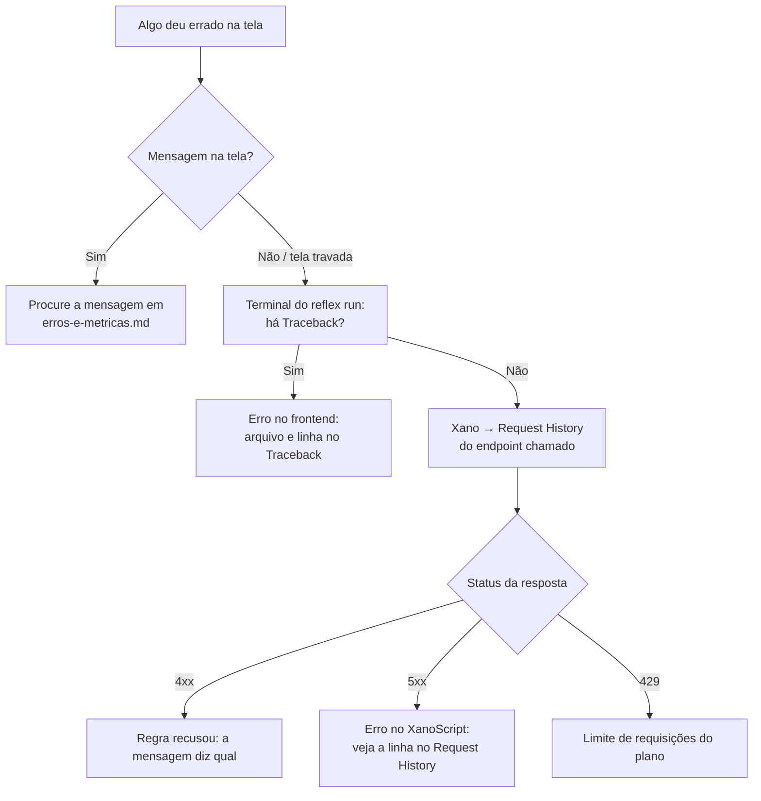

# Runbooks e depuração

Como o sistema se comporta rodando, por onde começar a investigar uma falha e os procedimentos de reinício e de volta de versão.

## Como o sistema se comporta rodando

- **Navegador ↔ servidor Reflex:** cada aba mantém uma conexão WebSocket com o backend do Reflex (porta 8000 em desenvolvimento). O estado da tela fica no servidor. Se o servidor reiniciar, a tela recarrega e pede login de novo se a sessão local se perdeu.
- **Servidor Reflex ↔ Xano:** cada ação faz uma chamada HTTPS ao Xano, com o token da sessão. Telas de acompanhamento e painéis consultam o Xano em intervalos (5 a 30 s).
- **Xano:** valida perfil e regra, grava numa transação e registra a auditoria. Não há tarefa agendada: nada acontece sem uma requisição. Por exemplo, um registro parado só é dispensado quando o Administrador clica.

## Por onde começar



### Achar o código responsável

1. **Qual tela?** A rota está na barra de endereço. Em [mapa-telas-api.md](../manutencao/mapa-telas-api.md), veja o estado e os endpoints dessa rota.
2. **Qual endpoint?** Em [contratos-api.md](../manutencao/contratos-api.md), cada endpoint tem o arquivo `.xs`, a entrada, a resposta e as mensagens de erro. Procure o texto da mensagem com `grep -rn "texto" backend/xano`.
3. **Qual regra?** Os endpoints chamam funções ([funcoes-xano.md](../manutencao/funcoes-xano.md)). Funções puras podem ser rodadas isoladas:

   ```bash
   echo '{"fichas": [], "posicao": 1, "amarelas": 2, "azuis": 1, "limite": 5}' | \
     xano function run fila/prever_fila --json - --branch v1 -p ps-impacta -o json
   ```
4. **Qual dado?** Xano → Database → tabela; ou, para ver o que mudou e quem mudou, Administrador → **Auditoria** (filtro por usuário, tipo e período) e **Detalhe da ficha** (histórico completo da ficha).

### Ferramentas de diagnóstico

| Ferramenta | Onde | Mostra |
|---|---|---|
| Terminal do `reflex run` | Máquina que roda o frontend | Exceções Python do estado (Traceback), compilação e portas |
| Console do navegador (F12) | Navegador | Erros de JavaScript e de WebSocket |
| Xano → Request History | Painel do Xano, em cada endpoint | Entrada, saída, status, tempo e a linha onde o XanoScript falhou |
| `xano function run` | Terminal | Executa uma função com dados de teste |
| Auditoria | `/admin/auditoria` | Quem alterou o quê e quando; logins e logouts |
| Evidências do CI | GitHub → Actions → execução → Artifacts | Resultado de cada teste por ID do catálogo |

## Runbooks

### Telas com "Reconectando…" ou erro de conexão em toda a equipe

1. Teste a API direto: `curl -s -o /dev/null -w "%{http_code}" "<XANO_FILA_API_URL>/painel"`.
2. **429** → limite do plano. Feche abas de painel e telas abertas à toa (cada painel faz 4 requisições a cada 20 s; o limite é 10). Pare `reflex run` duplicados (portas 3001, 8001…). O sistema volta sozinho em segundos.
3. **000 / tempo esgotado** → rede ou Xano fora. Confira a internet da máquina e o status do Xano.
4. **5xx** → erro no backend: abra o Request History do endpoint.

### Ninguém consegue entrar

1. A mensagem é "Código inválido ou expirado" para todos? Confira se os e-mails estão chegando. Sem e-mail, verifique `BREVO_API_KEY` e `BREVO_REMETENTE` no Xano e a cota da conta Brevo.
2. "Variável de ambiente ... não configurada." → crie a variável em Xano → Settings → Environment Variables ([lista](../manutencao/configuracao-e-regras.md#variáveis-de-ambiente-do-xano)).
3. "Configure XANO_AUTH_API_URL..." → falta a variável no `frontend/.env` da máquina que roda o Reflex.

### Uma pessoa não consegue entrar

- "Usuário inativo" → reative em Administrador → Usuários.
- Esqueceu a senha → "Esqueci minha senha" na tela de login (o Administrador não redefine senhas).
- Último Administrador inativo ou sem senha → só pelo Xano: Database → `usuario` (com o aval do dono do workspace).

### Médico não consegue chamar

Na tela do médico, confira o status (precisa estar **Disponível**). No Administrador, confira se ele tem **plantão** vigente em Plantões. Se já houver uma ficha chamada, ela precisa ser finalizada antes (Compareceu, Repetir chamada ou desistência).

### Fila parece fora de ordem

A ordem é calculada no momento da chamada ([regras](../referencia/regras-de-negocio.md#fila-do-médico)). Para conferir: Administrador → **Fila geral** mostra a posição prevista de cada ficha pela mesma regra. Uma Vermelha que entrou depois passa à frente; uma ficha descoberta pode ser chamada por um médico de outra especialidade. Isso é o comportamento esperado.

### Registros esquecidos abertos

Administrador → Início → "Fichas e tickets parados" → **Dispensar todos** (mais de 24 h sem andamento). Fica registrado na auditoria em nome do Administrador.

### Teste ao vivo interrompido deixou dados de teste

Os testes ao vivo criam pacientes "Paciente Fictício ..." e senhas com o marcador do teste (`V-CAR-<marcador>`). Se um teste parar no meio, rode a limpeza do cenário:

```bash
echo '{"marcador": "<marcador>", "finalizar_pendentes": true}' | \
  xano function run fila/teste_encerrar_cenario --json - --branch v1 -p ps-impacta -o json
```

## Reinício

| O quê | Como |
|---|---|
| Frontend | Ctrl+C no terminal do `reflex run` e rodar de novo. Se as telas ficarem estranhas depois de atualizar o código, apague `frontend/.web` e rode outra vez (recompila tudo) |
| Sessões da equipe | Cada pessoa sai e entra de novo. O logout do médico encerra todas as sessões abertas dele; o dos demais perfis encerra a mais recente |
| Xano | Não há reinício: é um serviço gerenciado. Mudanças valem assim que publicadas |

## Rollback

Veja [deploy e ambientes → rollback](deploy-e-ambientes.md#rollback).
