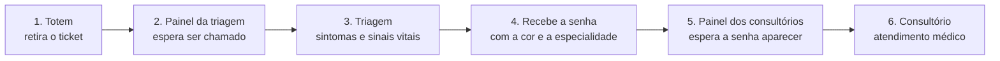

# Prioriza — Manual do usuário

**Sistema de Fila Prioritária para Pronto-Socorro.** Este manual explica, em linguagem simples, para que serve o sistema, como cada pessoa usa as telas e quais regras ele segue.

> Projeto acadêmico (Faculdade Impacta). As regras clínicas foram criadas para estudo e não substituem um protocolo real de triagem.

## Sumário

1. [O que é o Prioriza](#1-o-que-é-o-prioriza)
2. [O caminho do paciente](#2-o-caminho-do-paciente)
3. [Como acessar](#3-como-acessar)
4. [Paciente: Totem e painéis](#4-paciente-totem-e-painéis)
5. [Recepção/Triagem](#5-recepçãotriagem)
6. [Médico](#6-médico)
7. [Administrador](#7-administrador)
8. [As regras do sistema, explicadas](#8-as-regras-do-sistema-explicadas)
9. [Privacidade e segurança](#9-privacidade-e-segurança)
10. [Perguntas frequentes](#10-perguntas-frequentes)
11. [Palavras que aparecem nas telas](#11-palavras-que-aparecem-nas-telas)

---

## 1. O que é o Prioriza

Em muitos prontos-socorros, quem chega primeiro é atendido primeiro. O Prioriza muda isso: ele dá preferência a **quem está mais grave**, com base nos sintomas e nos sinais vitais medidos na triagem.

O sistema:

- **classifica** cada paciente em uma cor: 🔴 **Vermelha** (mais grave), 🟡 **Amarela** ou 🔵 **Azul** (menos grave);
- **escolhe sozinho** o próximo paciente que o médico vai chamar, seguindo regras iguais para todos;
- **mostra as chamadas** em painéis na sala de espera, sem mostrar o nome de ninguém;
- **registra** tudo o que é feito, para consulta posterior.

Quem usa:

| Quem | O que faz no sistema |
|---|---|
| **Paciente** | Retira um ticket no Totem e acompanha as chamadas nos painéis. Não precisa de cadastro nem de senha |
| **Recepção/Triagem** | Chama os tickets, identifica o paciente, faz a triagem e entrega a senha |
| **Médico** | Chama o próximo paciente e confirma se ele compareceu |
| **Administrador** | Cadastra a equipe e as configurações e acompanha o plantão |

## 2. O caminho do paciente

1. Na entrada, o paciente toca no **Totem** e recebe um **ticket**, como `N-012`.
2. Aguarda até o ticket aparecer no **painel da triagem**.
3. Na **triagem**, a equipe confirma quem ele é pelo CPF, pergunta os sintomas e mede pressão, batimentos, respiração, temperatura e oxigenação.
4. O sistema calcula a **cor** e a **especialidade** e gera a **senha**, como `A-CAR-003`. O paciente recebe um comprovante impresso.
5. O paciente aguarda até a senha aparecer no **painel dos consultórios**, com a especialidade e a sala.
6. Vai à sala indicada e é atendido.

## 3. Como acessar

O Prioriza é um site; não há aplicativo para baixar. Use o endereço do sistema informado pela equipe (em testes, `http://localhost:3000`).

| Para | Endereço | Precisa de senha? |
|---|---|---|
| Totem da entrada | `/totem` | Não |
| TV da sala de espera da triagem | `/painel/triagem` | Não |
| TV da sala de espera dos consultórios | `/painel/medico` | Não |
| Equipe (Recepção, Médico e Administrador) | `/login` | Sim |

### Entrar no sistema (equipe)

1. Abra `/login` e digite seu **e-mail** e sua **senha**.
2. Você recebe por e-mail um **código de 6 dígitos**. Digite-o na tela seguinte.
3. O sistema abre a sua tela inicial, de acordo com o seu perfil.

> **Primeiro acesso:** ninguém se cadastra sozinho. O **Administrador** cria o seu acesso e informa o e-mail e a senha inicial. Para trocar a senha, use **"Esqueci minha senha"** na tela de login.

Por segurança, o sistema sai sozinho depois de **1 hora sem uso** e, em qualquer caso, depois de **12 horas**. Basta entrar de novo; nada do que estava salvo se perde.

## 4. Paciente: Totem e painéis

### Totem

Toque no tipo de atendimento:

| Botão | Para quem | Ticket |
|---|---|---|
| **Pediátrico** | Crianças até 11 anos | `C-001`, `C-002`… |
| **Preferencial** | 60 anos ou mais, gestantes e demais pessoas com atendimento preferencial | `P-001`… |
| **Normal** | Todos os demais | `N-001`… |

O ticket aparece na tela. Guarde o código e toque em **Concluir**. Nenhum dado pessoal é pedido.

### Painéis da sala de espera

| Painel | Mostra |
|---|---|
| **Triagem** | O ticket chamado agora, em destaque ("Dirija-se à Recepção/Triagem"), e os últimos tickets chamados |
| **Consultórios** | A senha chamada agora, com "Dirija-se à {especialidade} · {sala}", e as últimas senhas chamadas |

- A cada chamada, a senha pisca e toca um aviso sonoro.
- Se a mesma senha aparecer de novo com "2ª chamada" ou "3ª chamada", é porque a pessoa ainda não se apresentou.
- Os painéis **nunca** mostram nome, CPF ou informação de saúde.

## 5. Recepção/Triagem

### Tela inicial

Mostra o resumo do plantão e o campo **Meu status**. Escolha **Disponível** ao começar, **Pausa** em um intervalo e **Ausente** ao sair. O Administrador vê o status de cada pessoa da equipe.

### Chamar os tickets — "Fila de pré-triagem"

1. Clique em **Chamar próximo**. O sistema escolhe o ticket certo (seção 8) e ele aparece no painel da triagem.
2. Se a pessoa não vier, espere o tempo indicado na tela e use **Chamar novamente** (até 3 vezes).
3. Ainda sem a pessoa: **Não compareceu**. Na primeira vez, o ticket volta para o fim da fila; na segunda, sai da fila.
4. A pessoa chegou: **Marcar presente** e depois **Identificar paciente**.
5. Se a pessoa desistir de esperar: **Desistência**.

Nada acontece sozinho: sem um clique, o ticket fica parado esperando.

### Identificar o paciente

1. Digite o **CPF** e pesquise.
2. **Primeira visita:** preencha nome completo, data de nascimento e telefone (opcional) e salve.
3. Clique em **Continuar** para abrir a ficha.

Se o paciente já tiver uma ficha aberta, a tela oferece **"Abrir ficha atual"**, para não duplicar.

### Fazer a triagem — "Ficha de atendimento"

1. **Sintomas:** busque e marque os sintomas da lista. Se não encontrar, use **Adicionar** para um sintoma não listado e escolha a gravidade (1, 2 ou 3).
2. **Observação:** escreva a queixa do paciente, se quiser.
3. **Sinais vitais:** pressão (máxima), batimentos por minuto, respirações por minuto, temperatura e oxigenação (SpO₂). A glicemia é opcional. Marque **Gestante** quando for o caso.
4. A **cor aparece sozinha** quando os dados estiverem completos. Se faltar algo, a tela avisa o que é.
5. Se discordar da cor, use **Ajustar prioridade**, escolha a cor e escreva a **justificativa** (obrigatória).
6. Clique em **Confirmar e gerar senha**. O sistema define a especialidade, gera a senha e abre o **comprovante** para imprimir. Entregue o comprovante ao paciente.

> Para crianças menores de 16 anos e gestantes, o sistema não calcula a cor sozinho. A tela pede que você escolha a cor e explique o motivo.

### Corrigir uma ficha — "Fichas do dia"

Lista as fichas de hoje, com busca por nome ou senha. Enquanto o paciente ainda **não foi chamado pelo médico**, é possível abrir a ficha e corrigir sintomas, sinais vitais ou cor:

- se só a cor mudar, a senha troca a letra e mantém o número (`A-CAR-003` vira `V-CAR-003`);
- se mudar a especialidade, sai uma senha nova. **Reimprima o comprovante** e entregue o novo ao paciente.

## 6. Médico

1. Ao entrar, clique em **Ficar disponível**. O sistema começa com você indisponível, para não receber pacientes sem querer.
2. Clique em **Chamar próximo**. **O sistema escolhe o paciente**; a senha aparece no painel dos consultórios e a ficha aparece na sua tela, com sintomas, sinais vitais e histórico.
3. O paciente chegou: **Compareceu**. Seu status passa a **Em atendimento**, e você pode **Imprimir** a ficha.
4. O paciente não veio: espere 30 segundos e use **Repetir chamada** (até 3 vezes). Se ele não vier, a ficha volta uma vez para o fim da fila; na segunda vez, é encerrada como desistência.
5. Se o paciente avisar que vai embora: **Registrar desistência** (pede confirmação).
6. Para parar de receber pacientes: **Pausar** ou **Ausente**. Para voltar: **Ficar disponível**.

Em **Meus plantões**, você vê os plantões que o Administrador cadastrou para você.

## 7. Administrador

| Menu | Para que serve |
|---|---|
| **Início** | Plantão do dia, quem está conectado e o status de cada um. Mostra fichas e tickets parados há mais de 24 horas, com o botão **Dispensar todos** |
| **Fila geral** | Todos os pacientes em triagem, aguardando e chamados, na ordem em que serão chamados. Só para consulta; atualiza sozinha |
| **Detalhe da ficha** | Tudo o que aconteceu com uma ficha: triagem, senhas, ajustes, chamadas e histórico |
| **Auditoria** | Quem fez o quê e quando: alterações, chamadas e entradas no sistema. Pode exportar para planilha (CSV) |
| **Usuários** | Criar e editar o acesso da equipe, trocar o perfil, ativar e desativar |
| **Médicos** e **Recepção/Triagem** | Dados profissionais: CRM, especialidades e sala do médico; CPF da Recepção |
| **Especialidades**, **Sintomas** e **Salas** | O que o PS atende, a lista de sintomas com pontos e destino, e as salas |
| **Plantões** | Quando cada médico está de plantão (pode repetir em escala 12x36) |
| **Parâmetros** | Os números das regras: limites das cores, idades, tempos de chamada, ciclos e prazos. Cada valor tem um mínimo e um máximo permitidos |

Boas práticas:
- Nada que tem histórico é apagado: é **desativado**. Toda mudança fica na Auditoria, com o seu nome.
- Você não consegue desativar a si mesmo nem o último Administrador.
- O Administrador **acompanha**, mas não faz triagem nem chama pacientes.

## 8. As regras do sistema, explicadas

### Quem é chamado primeiro na triagem

- Tickets **Pediátricos** vêm antes dos **Preferenciais**.
- Para ninguém esperar para sempre, a cada **2 tickets prioritários** é chamado **1 Normal**.

### Como a cor é decidida

Cada sintoma vale de **1 a 3 pontos**, e cada sinal vital fora do normal soma de **1 a 3 pontos**. O sistema soma tudo:

| Total de pontos | Cor |
|---|---|
| 0 a 4 | 🔵 Azul |
| 5 a 9 | 🟡 Amarela |
| 10 ou mais | 🔴 Vermelha |

**Atenção:** um único item muito grave (3 pontos), como oxigenação de 91% ou um sintoma de 3 pontos, já torna a ficha **Vermelha**, mesmo com poucos pontos no total.

*Exemplo:* dor no peito (2) + falta de ar (2) + batimentos em 115 (2) = 6 pontos → **Amarela**.

**Idosos (60+), crianças (até 11) e gestantes** passam à frente das outras pessoas **da mesma cor**, mas isso não muda a cor.

### Para qual especialidade o paciente vai

- Crianças até 11 anos vão para a **Pediatria**.
- Os demais vão para a especialidade do sintoma mais grave. Por exemplo, dor no peito leva à Cardiologia.
- Sem nenhum sintoma da lista, o paciente vai para a **Clínica Geral**.

### O que a senha quer dizer

A senha `A-CAR-003` significa: **A** = Amarela (V = Vermelha, B = Azul), **CAR** = Cardiologia, **003** = terceira senha da Cardiologia hoje.

### Quem o médico chama

- Primeiro os **Vermelhos**. Depois, a cada **2 Amarelos**, **1 Azul**.
- O médico atende primeiro as suas especialidades, mas pode ajudar outra especialidade que esteja sem médico, quando lá houver alguém mais grave.
- Dois médicos nunca chamam o mesmo paciente.

### Chamadas e ausências

| Onde | Espera entre chamadas | Chamadas por vez | Se não comparecer |
|---|---|---|---|
| Triagem | 30 s depois da 1ª; 10 s depois das seguintes | até 3 | Volta ao fim da fila uma vez; na segunda, sai da fila |
| Médico | 30 s | até 3 | Volta ao fim da fila uma vez; na segunda, desistência |

### Painéis

As chamadas ficam na tela por **2 horas**, o que funciona mesmo com o PS aberto 24 horas. A sala mostrada é a sala cadastrada para o médico.

> Os números acima são os valores iniciais. O Administrador pode ajustá-los em **Parâmetros**.

## 9. Privacidade e segurança

- Os painéis e o comprovante **não mostram** nome, CPF, sintomas nem sinais vitais.
- Nas telas da equipe, o CPF aparece escondido (`***.456.789-**`), exceto onde precisa ser digitado.
- Cada pessoa vê só as telas do seu perfil.
- Tudo o que é alterado fica registrado na Auditoria.
- O texto completo sobre os dados está em **Aviso de privacidade**, no rodapé da tela de login.

## 10. Perguntas frequentes

**Acesso**

| Pergunta | Resposta |
|---|---|
| O código não chegou no e-mail. | Olhe a caixa de spam. Depois de 60 segundos, use **Reenviar**. |
| Apareceu "Código inválido ou expirado". | O código está errado, vencido ou já foi usado. Peça um novo. Errar muitas vezes bloqueia aquele código. |
| Apareceu "Usuário inativo". | Seu acesso foi desativado. Fale com o Administrador. |
| Esqueci a senha. | Use **"Esqueci minha senha"** na tela de login. |
| O sistema me mandou de volta para o login. | Ficou 1 hora sem uso ou passou o tempo da sessão. Entre de novo; nada se perde. |
| Abri um endereço e caí na minha tela inicial. | Aquela tela é de outro perfil. |

**Triagem**

| Pergunta | Resposta |
|---|---|
| A ficha não mostra a cor. | Falta algum sinal vital, ou o paciente tem menos de 16 anos ou é gestante. Complete os dados ou ajuste a cor com justificativa. |
| O paciente já tem uma ficha aberta. | Use "Abrir ficha atual" na identificação, ou "Fichas do dia". |
| Corrigi a ficha e a senha mudou. | Mudou a especialidade. Reimprima o comprovante. |
| Não consigo mais alterar a ficha. | O médico já chamou o paciente. Depois da chamada, a ficha não pode ser mudada. |
| Quero ajustar a cor. | Use **Ajustar prioridade**; a justificativa é obrigatória e fica registrada. |

**Médico**

| Pergunta | Resposta |
|---|---|
| Não consigo chamar. | Confira se está **Disponível**, se tem plantão cadastrado hoje e se não há outro paciente chamado esperando sua confirmação. |
| Apareceu "Aguarde N segundos para repetir a chamada". | É o tempo mínimo entre chamadas. Espere e tente de novo. |
| Por que o sistema chamou alguém de outra especialidade? | Aquela especialidade estava sem médico e havia um caso mais grave. |
| Por que não posso escolher o paciente? | Para garantir a mesma regra para todos: o sistema chama sempre o mais adequado naquele momento. |

**Painéis e uso geral**

| Pergunta | Resposta |
|---|---|
| O painel mostra "Reconectando…". | A conexão caiu por um momento. O painel continua mostrando a última informação e volta sozinho. Deixe só uma aba de cada painel aberta. |
| O painel não toca som. | Toque uma vez em **"Toque para ativar o som"**. O navegador exige isso. |
| Uma ficha ficou esquecida aberta desde ontem. | O Administrador usa **Dispensar todos** na tela Início. |
| Telas da equipe mostram erro de conexão. | Feche abas e painéis abertos sem uso, espere alguns segundos e tente de novo. |

## 11. Palavras que aparecem nas telas

| Palavra | Significado |
|---|---|
| **Ticket** | Código do Totem (`C-`, `P-` ou `N-`), usado até a triagem |
| **Senha** | Código depois da triagem (`V-`, `A-` ou `B-` + especialidade + número), usado até o médico |
| **Ficha** | O registro da visita do paciente: sintomas, sinais vitais, cor e senha |
| **Escore** | O total de pontos que define a cor |
| **Condição prioritária** | Idoso, criança ou gestante: passa à frente dentro da mesma cor |
| **Oportunidade** | A vez do paciente na fila. Cada oportunidade tem até 3 chamadas |
| **Desistência** | Saída da fila sem atendimento |
| **Plantão** | Período em que o médico está trabalhando |
| **Em atendimento** | O médico está com um paciente; o sistema marca sozinho |
| **Auditoria** | O registro de tudo o que foi feito, por quem e quando |
